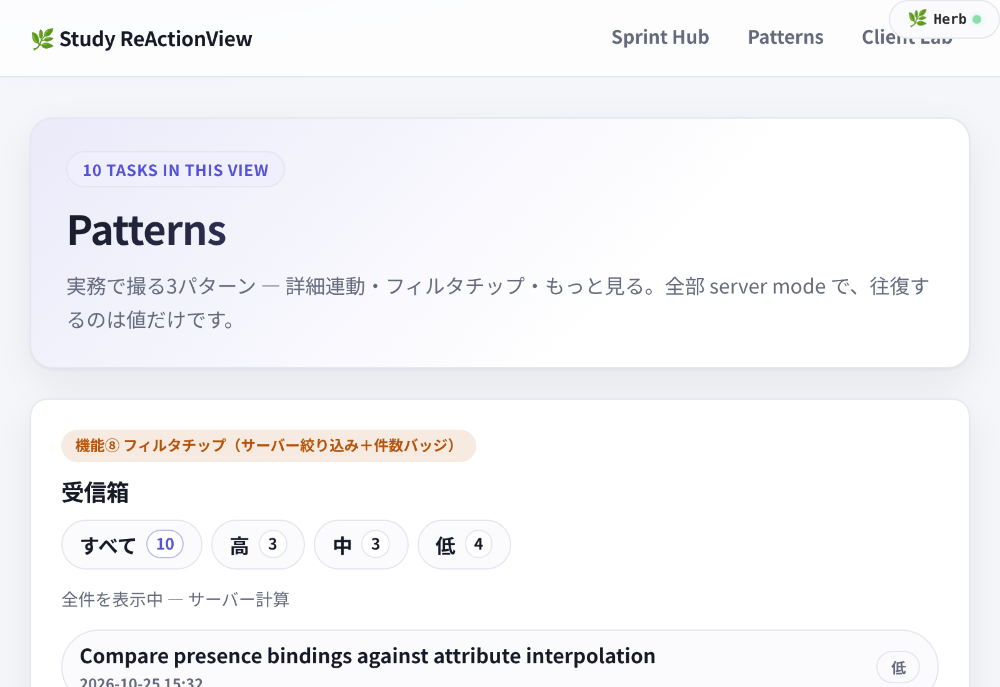
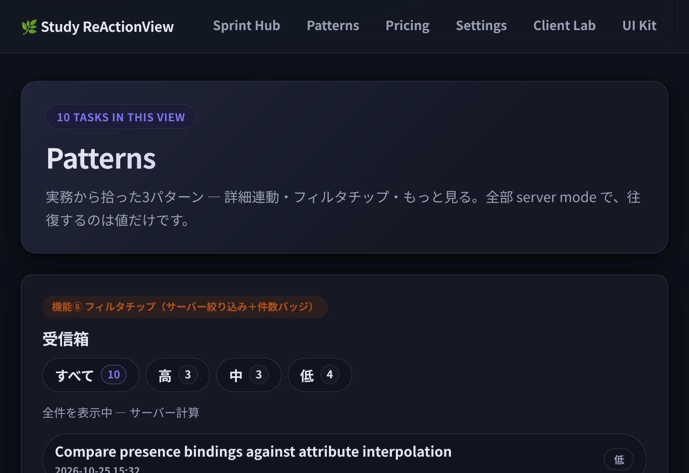
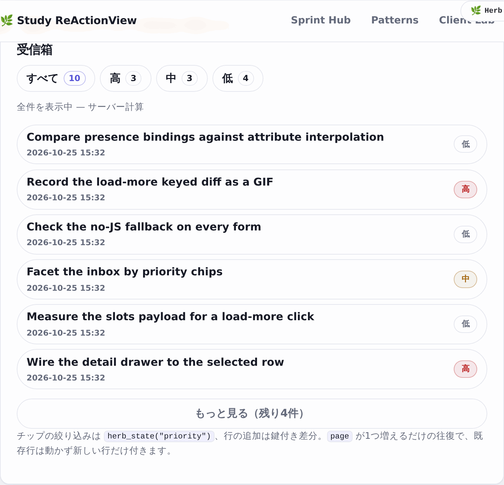
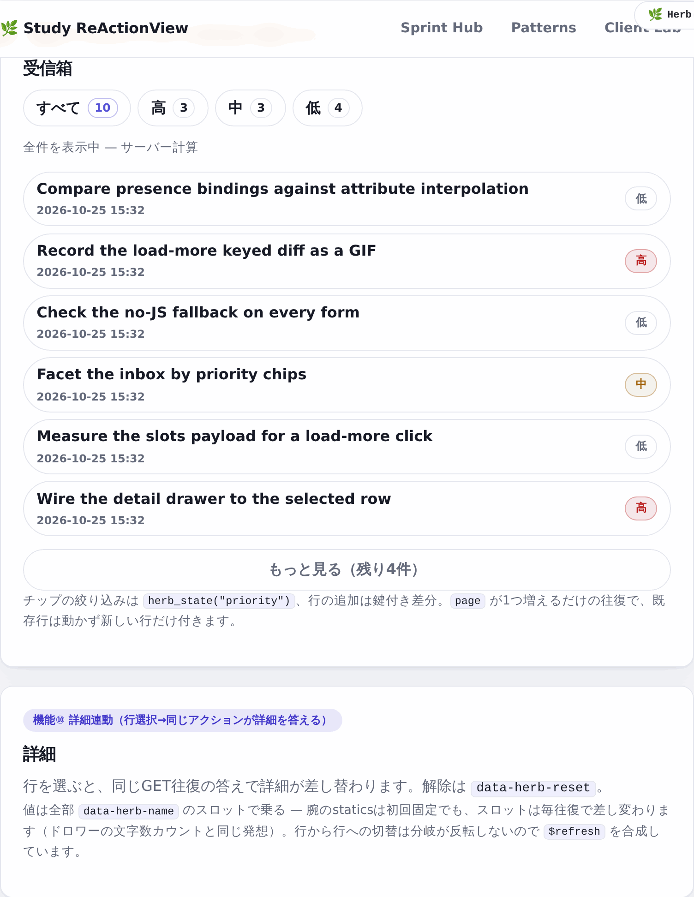
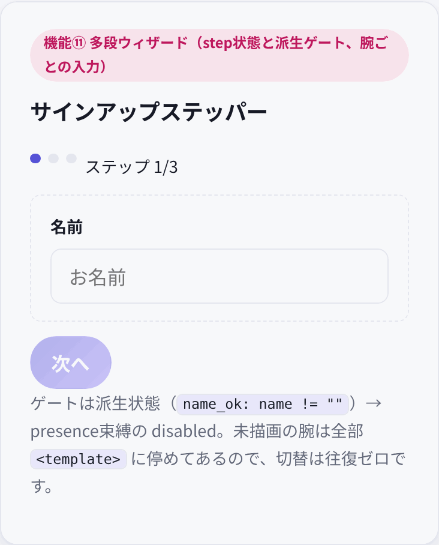
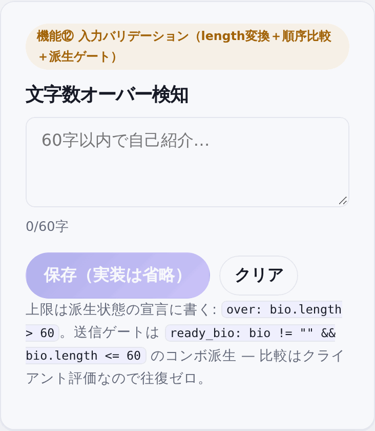
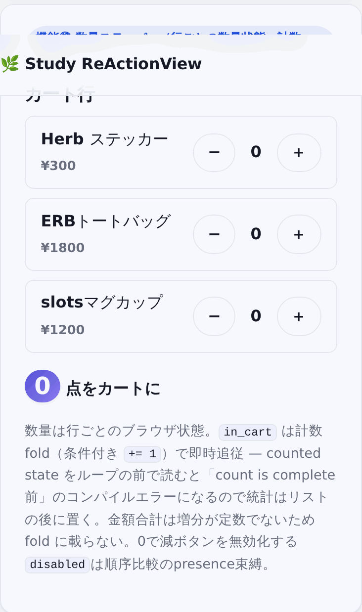
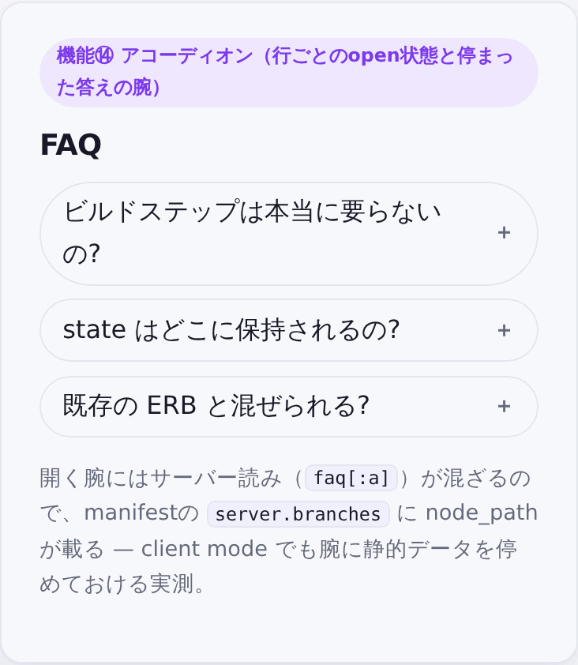

# Study ReActionView

**ReActionView 0.6.0 + Herb 0.11.1 の検証ショーケース**であり、Kaigi on Rails 2026（Marco Roth: "Herb in Rails"）の主張、
すなわち **ERB のみで Phoenix LiveView 的な細粒度リアクティビティが成立する** ことを、実用的なアプリ風の
五つのショーケースで実演・検証する。

- React / Stimulus / Node / yarn / ビルドパイプライン: 一切なし。`app/javascript/application.js` は
  `import "reactionview"` の 1 行だけ。スタイルは `app.css` 1 枚の素の CSS（デザイントークン含む）。
- 細粒度の更新は Herb の slots が担う。state 変化に対して、HTML ではなく値の JSON
  （`application/vnd.herb.slots+json`）だけが往復し、クライアントが差分を当てはめる。
- Hotwire（Turbo + Stimulus）が担っていた役割ごとの対比ノートは [docs/hotwire-comparison.md](docs/hotwire-comparison.md)。

## 5つの画面

| 画面 | 宣言 | 見せていること |
|---|---|---|
| Sprint Hub `/` | `<%# herb:slots server %>` | サーバーが答える読み取り、key 付き行の差分更新、楽観的追加 |
| Patterns `/patterns` | `<%# herb:slots server %>` | 実務から拾った3パターン: フィルタチップ、もっと見る、詳細連動 |
| Pricing `/pricing` | `<%# herb:slots server %>` | サーバーが計算する見積もり、steering、presence、READ slot |
| Client Lab `/lab` | `<%# herb:slots client %>` | 未描画分岐の格納（parking）、派生状態、サーバー往復ゼロのUI |
| UI Kit `/ui` | `<%# herb:slots client %>` | shadcn/ui モデルの検証キット reactionview-ui（9コンポーネント、全操作スロット往復 0） |

```console
$ bin/rails db:setup   # または db:seed
$ bin/rails server     # http://localhost:3000
```

## Sprint Hub（server モード、`/`）

検索・並び替え・追加はすべてサーバー側で行う。state はリクエストごとにブラウザからサーバーへ渡り、
同じアクションが HTML ではなく値で応える。

<div> </div>

### 機能① サーバーが答える読み取り


- 検索語・並び順は `herb_state("query")` / `herb_state("order")` としてコントローラーでも宣言し、
  ビューとコントローラーの両方が同じ名前で読む。これで最初の描画から filter が効く。
- 入力は `data-herb-debounce="220"`。打鍵のたびの往復を 220ms にまとめて、同じ `GET /?format=slots` が答える。
- リストの行は `<%# herb:key %>` 付き → 応答は `{items, order}` のキー付き照合になり、行は移動する
  （再構築しない）。並び替え GIF で行がアニメーションせず“その場で並び替わる”のは、キーのおかげだ。
- `$refresh`（🔄 同期）だけが明示的な「サーバーに全部問い合わせ直す」手段だ。

### 機能② 細粒度更新＋カウントfold


- 取り消し線・行の文言ピルは **presence バインディング**（`checked="<%= done %>"`）＋ CSS `:has(input:checked)`
  で即時描画する。ピルは「✔ 完了」「未完了」の両方を DOM に置いて CSS で表示を切り替えている。
  server モードではブラウザ所有 state を分岐の条件には書けない（未描画側が格納されず refetch storm になる）。
- 統計「N/M 件完了」は **カウントfold** で作る。キー付き行の中に
  `<% if done %><% done_count += 1 %><% end %>` の 3 タグを置くのが決まった形だ。manifest には
  `count: {by: 1, when: ["done"]}` として現れ、チェックのたびにサーバー往復なしで client が計算し直す。
- 「行の見た目を属性値の補間で表現しない」（`class="<%= … if done %>"` を書かない）のが原則だ。
  属性補間はサーバー読みスロットになり、チェックのたびの往復を生む。見た目は CSS、数値は read slot で分担する。

### 機能③ 楽観的追加


- 「＋ 新規タスク」でスライドインする backdrop ドロワー。分岐はサーバー描画のまま答える。
- 送信は楽観的で、ボタンを押すと応答を待たずに行が差し込まれる（`data-herb-into="tasks"`）。
  応答は 201 で新規行だけを返し、クライアントは `items` の splice で受ける。
- 送信に成功するとドロワーは閉じ、打ち込んだ title もリセットされる
  (`data-herb-set="submit->drawer_open=false"` と `data-herb-reset="submit->title"` の二本立て)。
- hero の合計（`Task.count`）は GET 応答では更新されるが、POST splice ではされない。
  0.6.0 のクライアントが 201 で適用するのは collection だけだ。だからシーンの最後で 🔄 同期を押して
  「楽観 → 確認」の流れを見せている（実測の制約は AGENTS.md にある）。
- JS を切っても成立する。hidden token 付きのふつうの `<form method="post">` として POST し、flash 付き redirect が返る。

### 機能④ window 句


- `data-herb-set="keydown.meta+b@window->drawer_open=true"` で、⌘B（Ctrl+B）でもドロワーが開く。
  要素の外（window）にリスナーを張る句だ。`modifier AND match` の設計上、`meta+b` と `ctrl+b` は別句にする
  （1 行では OR にできない）。
- 閉じる側は `click@outside->…=false` と `keydown.esc@window->…=false` の複合だ。

## Patterns（server モード、`/patterns`）

同じ tasks テーブルを「受信箱」として組み直した、実務寄りの3パターン。すべて server mode で、
往復するのは値だけ（検索・並び替えと同じ約束）。

<div> </div>

### 機能⑧ フィルタチップ（サーバー絞り込み＋件数バッジ）



- 優先度（1=低/2=中/3=高）は `tasks.priority` 列。チップの絞り込みは `herb_state("priority")` を
  コントローラーとビューの両方で読む（hub の検索と同じ約束）。
- チップのクリックは 1 属性に 2 state を代入する: `data-herb-set="priority=3 page=1"`。
  空白で区切った token は別 binding として各々実行される（クライアント実装の実測）。
- **往復が起きる条件は「state を読む分岐を作る」こと**: server mode では、分岐の答えが反転したときにだけ
  GET slots が飛び、ヘッダには「分岐の条件が読んでいる state」しか載らない（ブラウザ実測）。
  だからノートは priority の if/elsif 連鎖にして、全遷移でどこかの分岐が反転するようにしてある。
  これがないと、同一要素に `data-herb-action="$refresh"` を合成しても state が載らない。
- 選択中チップは `aria-pressed` の文字列補間。CSS は `[aria-pressed="true"]`。
  **state 比較は literal のみ**（`value.to_s` のような式は ErrorInTemplate）なので、
  チップは4個を literal 展開している。
- 件数バッジは `Task.group(:priority).count`。スカラーとして slots 応答に乗る。

### 機能⑨ もっと見る（キー付き差分で行が増える）


- `page` は Integer state。「もっと見る」は `data-herb-increment="page"`＋`data-herb-action="$refresh"`
  （2ページ目→3ページ目は分岐が反転しないので、`$refresh` の合成で往復を保証する）。
  同じ GET slots 往復で `order`/`items` が伸び、クライアントは既存行を動かさず新しい行だけを追加する。
- 「N ページ目を表示中」は `page > 1` の if（else無し）で、ページ state を分岐に読ませる役割も兼ねる。
- 「全部読み込みました」を表示する分岐は **ivar 条件の分岐**（`<% if @remaining > 0 %>`）だ。
  server モードでは state 条件でなくても wire に `branch` 値と分岐の statics が乗り、
  初期 HTML の `<!--herb-branch:N:現在の分岐-->` マーカーと突き合わせて切替が起きる。

### 機能⑩ 詳細連動（行選択→同じアクションが詳細を答える）



- 行クリックは `data-herb-set="click->selected_id=<%= task.id %>"`＋`data-herb-action="$refresh"`。
  行から行への切替は `selected_id > 0` の分岐が反転しないので `$refresh` を合成する
  （ヘッダは timer 発火時に組み立てられるので、1 リクエストに新 state が載る）。
- 詳細パネルの条件は `selected_id > 0`（**state 条件でないと往復が発生しない**。ivar 条件は
  wire に乗るだけで steering しない。いずれも実測）。値は全部 `data-herb-name` の名前付きスロットで乗る
  （分岐の statics は初回固定でも、スロットは毎往復差し替わる。ドロワーの文字数と同じ理屈だ）。
- 行のハイライトは `aria-current="<%= task.id == @selected_id %>"` で行う。**loop データとの比較は
  state に書けない**ので、controller 渡しの ivar と比較して、per-item の属性スロットとして往復する。
  キー付き item の中の属性補間が wire に乗ることは実測済み（`aria-current`、prio クラスとも）。
- 選択解除は `data-herb-reset="selected_id"`。消えた行の ID が選択された場合は
  値が空の詳細パネル側（state 条件の答え）になる。消えた行のデータが表示に残ることはない。

## Pricing（server モード、`/pricing`）

SaaS の料金プランを選ぶと見積もりが変わる計算画面。プラン・席数・年払い・優先サポートは
ブラウザ所有の state で、金額の計算はすべて Ruby 側に残す。JavaScript には料金式を書かない。

- `plan` は state 条件の分岐が反転して1往復する。`seats` / `annual` / `support` は分岐が
  反転しないため、steering 用の非反転条件（`seats > 0`、`annual == true || annual == false`、
  `support == true || support == false`）と `data-herb-action="$refresh"` の合成で1往復させる。
  これらの条件は常に真だが、state を steering ヘッダに載せるために読ませている。
- 内訳の金額は `data-herb-name` の READ slot。ボリューム割引・年払い割引・優先サポートの行は
  分岐の中に置かず、`hidden` 属性で出し分ける（ボリュームは state の presence、年払い・サポートは
  正規化した値）。分岐の中のサーバー読みは切替後に branch refetch を1回呼ぶため（0.6.0 実測）、
  金額は分岐の外に置くのが定石だ。
- headless Chromium で、プラン・席数・年払い・サポートの各操作が **1 リクエスト**で
  内訳と合計を更新することを確認済み。ページはリロードされない。
- JavaScript を切ると初期表示のみで、再計算はできない（no-JS の再計算は対象外）。
- 画像/GIF は未収録（必要なら撮影環境で追加）。

```erb
<%# herb:state (plan: "team", seats: 5, annual: false, support: false) %>
<p data-herb-name="total"><%= number_to_currency(@total, unit: "¥", precision: 0) %></p>
```

## Client Lab（client モード、`/lab`）

この画面の未描画の分岐（タブの裏側・モーダル・hover の表示）は、初回 HTML に `<template data-herb-region>`
として格納済みだ。開閉・切替・カウントはすべてブラウザ内で完結する。`$refresh` だけが意図的にサーバーへ問い合わせ直す手段だ。

<div> </div>

### 機能⑤ 分岐の格納とセグメント切替


- `tab` の両側（すべて / メンション）は、client モードでもサーバーが初回に両方を描画して格納する。
  切替はクライアントが格納済みの分岐を採用するだけだ。メンション側は
  `@notifications.select { |n| n[:kind] == "mention" }` の行データとして別に格納してある。
- `aria-pressed="<%= tab == "all" %>"` は文字列 "true"/"false" の属性補間として出る
  （checked/selected の boolean 属性バインディングとは別物）。client モードでは状態の比較だけだから、
  クライアント側で評価でき、往復はない。CSS は `[aria-pressed="true"]` で引く。

### 機能⑥ カウンタとコマンドパレット


- `data-herb-increment / decrement / reset` でカウンタを操作する。`data-herb-by="2"` を付けると一度に ±2 動く。
- ⌘K（Ctrl+K）またはクリックで開く palette 型モーダル。Esc と backdrop のクリックで閉じる。入力の文字数は即時に表示される。
- `data-herb-reset`（引数なし）は「全部戻す」で、全 states を既定値へ戻す。

### 機能⑦ switch バインディングと派生状態


- `checked="<%= mute %>"` の switch は presence バインディングだ。🔕/🔔 の文言も両方置いて CSS で切り替える（機能②と同じ理屈）。
- `<%# herb:state (draft: "", ready: draft != "") %>` が **派生宣言**だ。`draft` が空でなければ `ready` が真になり、
  文字数表示の即時化と `disabled="<%= !ready %>"` の送信ボタンの有効化がクライアント内で完結する。

### 機能⑪ 多段ウィザード（step状態と派生の有効化）



- `step`（Integer state）の三つ分岐は `<% if step == 1 %>` の別タグに展開した三ブロック
  （case+when を1タグに詰めると Herb がパース不能になるという教訓の if 版）。
- 「次へ」は `data-herb-increment="step"`。押せるかどうかは派生状態 `name_ok: name != ""` を presence バインドした
  `disabled` で決まる。ステップごとに入力が置ける（未描画のステップの input も格納してある）。
- 完了の分岐は `data-herb-reset="step name email"` で、複数 state を空白で並べて一気に戻せる。

### 機能⑫ 入力バリデーション（length変換＋順序比較＋コンボ派生）



- 派生宣言 `over: bio.length > 60` に `.length` 変換と順序比較が書ける。オーバー時は警告ピルの表示が差し替わる。
- 送信の有効化はコンボ派生 `ready_bio: bio != "" && bio.length <= 60` だ。manifest には
  `{"all" => [["bio","","!="], ["bio",60,"<=","length"]]}` として現れる。
- 演算（20 - length など）は不可能（変換は `.length` / `.to_s` のみ）。だから表示は「N/60字」の形。
- textarea は `<textarea><%= bio %></textarea>` の raw_text ではなく **`value="<%= bio %>"` でバインドする**。
  raw_text は textContent しか書かないので、一度でも打つと reset が表示に追従しなくなる（実測）。
  `value=` 形式なら textarea も双方向に結び付けられ、クリアで表示の値まで空になる。

### 機能⑬ 数量ステッパー（行ごとの数量＋カウントfold）



- `qty` は行ごとの Integer state。減ボタンは `disabled="<%= qty == 0 %>"` で、順序比較の presence バインディングにより
  0 のときは押せなくなる（見た目の即時性は CSS、数値は read スロットという分担は hub と同じ）。
- `<%= in_cart %>` 件の合計は**カウントfold**（`<% if qty > 0 %><% in_cart += 1 %><% end %>`）。
  fold の when に順序比較が書ける。counted state をループの**前**で読むとコンパイルエラー
  （「count is complete 前」）になるので、統計行はリストの後に置く。
- 金額合計は作れない: fold の増分は整数リテラルのみ（`total += price * qty` は不可）。

### 機能⑭ アコーディオン（行ごとの open 状態と hidden の presence バインディング）



- `open` は行ごとの boolean state。ヘッダーは `data-herb-toggle="open"`。
- **答えのテキストを分岐の中に置かない**: 行ごとの分岐は materialize できても、分岐の中に置いた
  サーバー読みの値は空で届く（0.6.0 の実測。ワイヤは item ごとの `{branch, slots}` を返しているのに、
  クライアントが materialize 済みの item の分岐に値を当てはめられない）。代わりに本文は平常の item part として
  初回から DOM に載せ、`hidden="<%= !open %>"` の presence バインディングで表示を切り替える。マーカーの＋/－は
  静的テキストなので分岐の切替で差し替わる。
- `hidden` は `checked/selected/disabled` に加わる presence の仲間（falsy 読みとして manifest に現れる）。
  CSS は `[hidden] { display: none !important; }` のガードで表示規則に勝たせない。

## UI Kit（client モード、`/ui`）

shadcn/ui のモデル（ソース配布 + トークン + variant API）を ERB で再現した検証キット。9コンポーネントのソースを
`lib/reactionview_ui/` に置き、ジェネレータ（`reactionview_ui:install` / `reactionview_ui:component`）で
`app/views/components/ui/` にコピーして使う。断片は `herb:state` 宣言を内蔵する。ページ側の wiring は不要。
headless Chromium で全コンポーネントを操作した結果、全操作でスロット往復 0 だった。
コンポーネントの一覧と実測の詳細は [docs/ui-kit.md](docs/ui-kit.md)。

## 検証の進め方

- **統合テスト: `bin/rails test`**。`tasks_controller_test` / `patterns_controller_test` / `pricing_controller_test` /
  `showcase_controller_test` / `ui_controller_test` が検証する振る舞いは、
  HTML レンダ / `herb_state` による並び替え・絞り込み / 料金計算と READ slot / slots 応答の形状
  （items+order / 分岐 / スカラー混在）/ 201 splice / no-JS フォールバック / fold が manifest に現れることだ。テストは What を、
  コードは How を、コミットログは Why を書く約束。
- 初期 HTML には `<template data-herb-manifests>` として、クライアントへの命令書が載る
  （`states.declarations` / `reads` / `conditionals` / `presence` / `computed` / `server`）。DevTools で覗くと
  「何が往復せず動くか」が読める。
- dev モードでは右上に Herb バッジが出る。テンプレートタグをわざと壊すと、ファイル名＋行番号付きの
  エラーオーバーレイが出る（各 footer に案内あり）。tests + curl + ブラウザでも説明がつかない局面では、
  `docs/debug-mcp-runbook.md`（debug-mcp の adopt-on-demand 手順）を参照する。

## テンプレートの実測メモ

この検証で判明したエンジンの事実（fold の決まった形、server モードと client モードの制約、slots ワイヤの形、
`<%# herb:state %>`を controller でも宣言する必要性など）は、[AGENTS.md](AGENTS.md) に随時記録している。
テンプレートを改変する前には必ずそこを当たること（境界を意図的に押して壊した記録が多い）。
