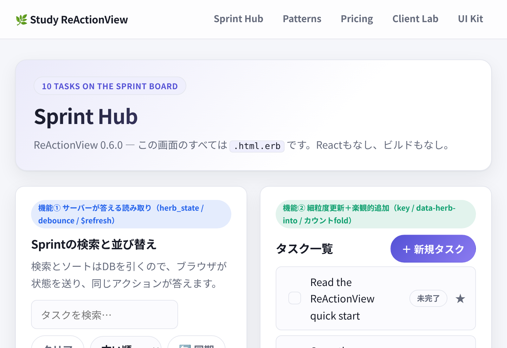
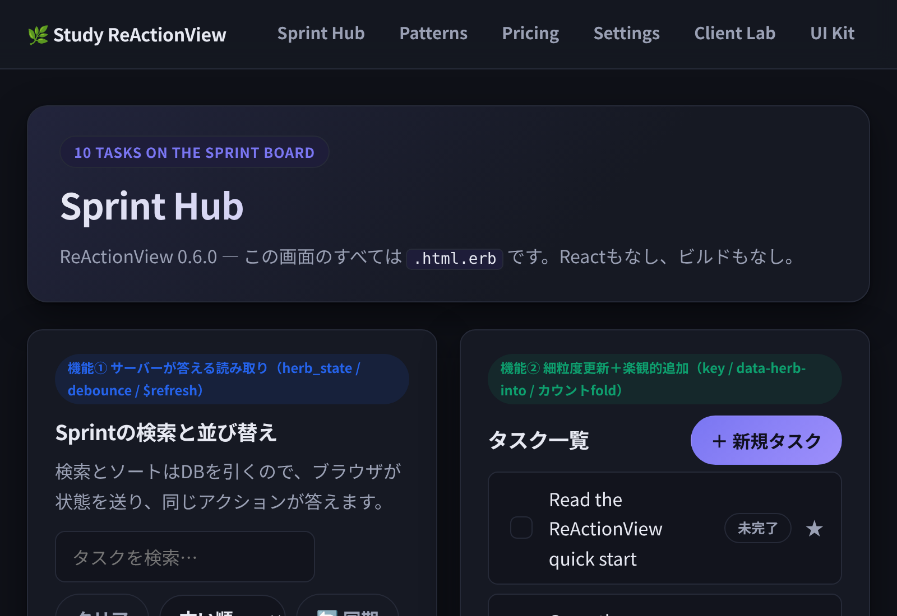
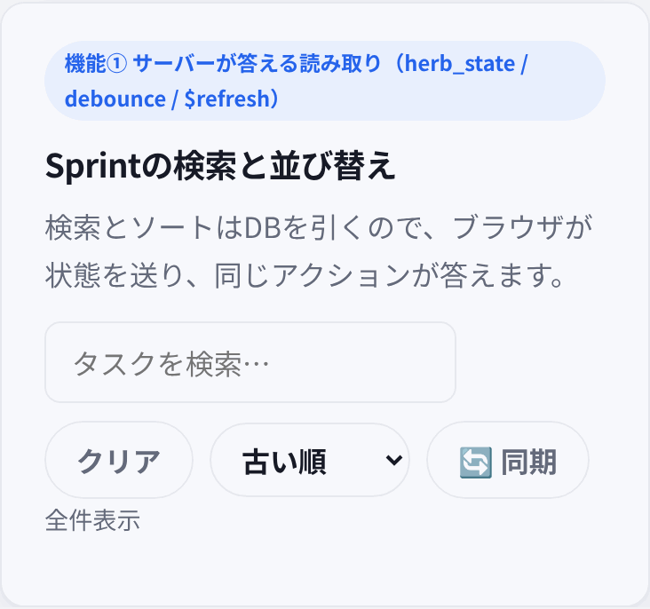
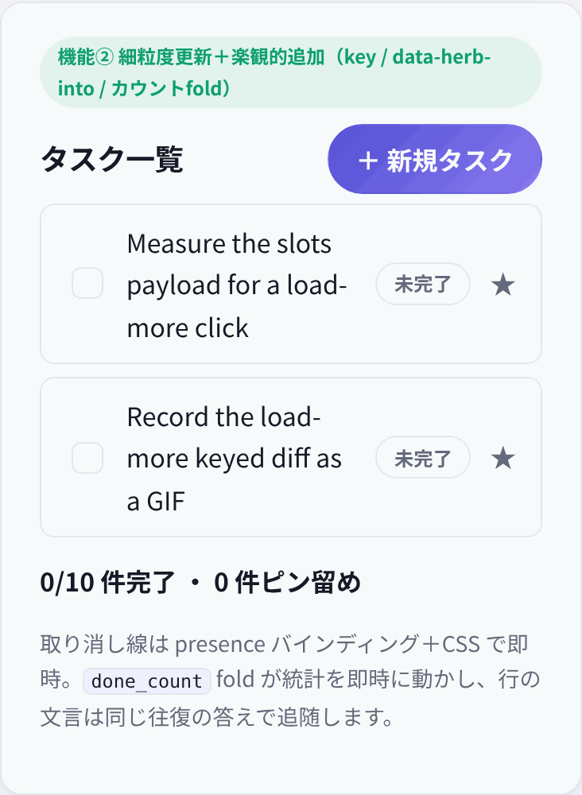
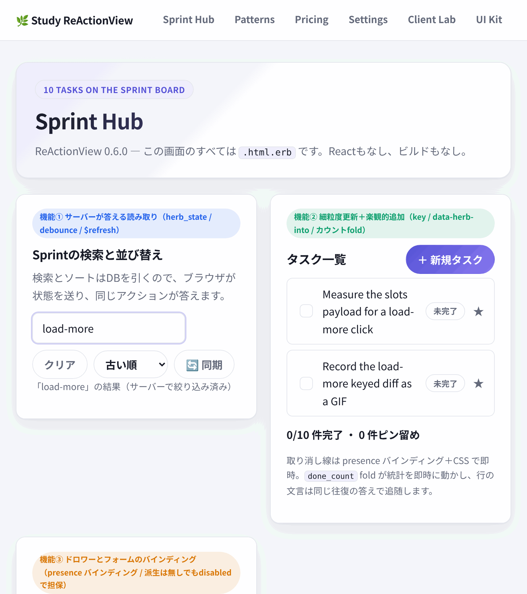
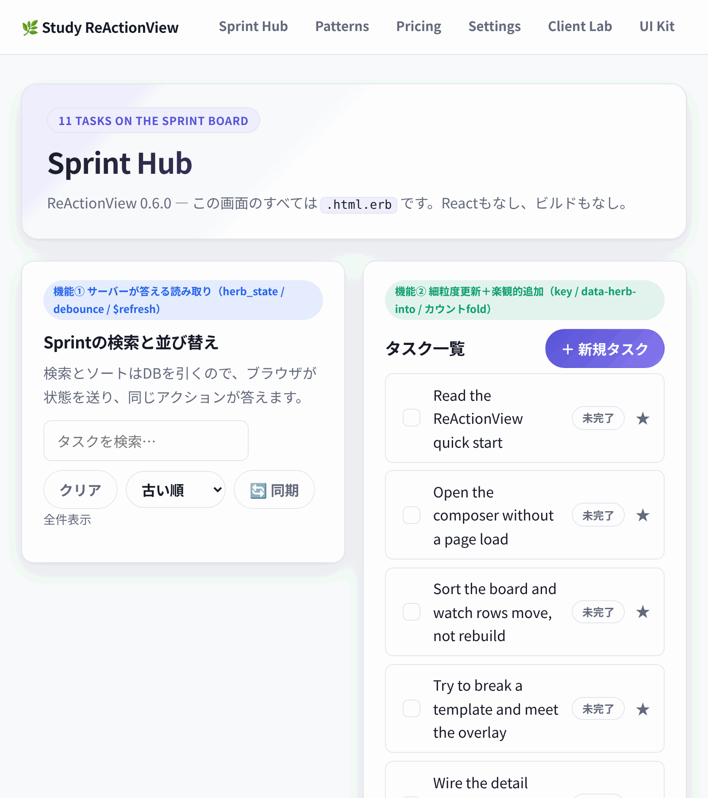
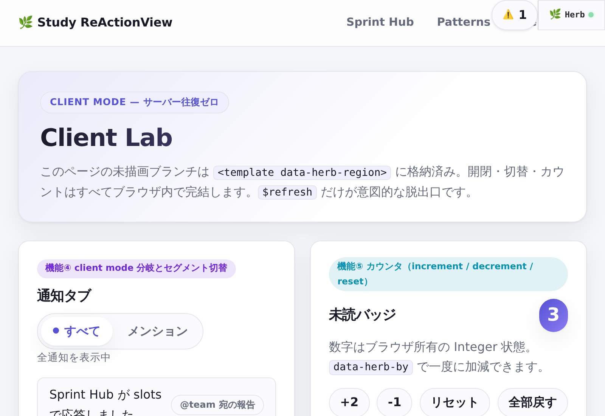
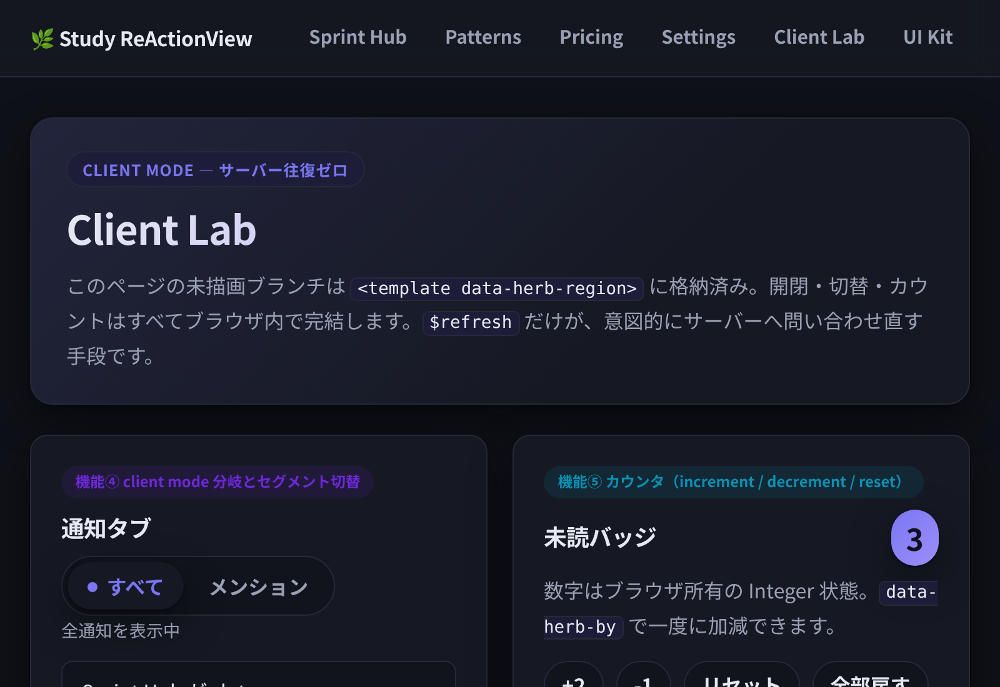

# Study ReActionView

**ReActionView 0.6.0 + Herb 0.11.0 の検証ショーケース**であり、Kaigi on Rails 2026（Marco Roth: "Herb in Rails"）の主張、
すなわち **ERB だけで React 的な細粒度リアクティビティが成立する** ことを、二つの実用的な画面で実演・検証する。

- React / Stimulus / Node / yarn / ビルドパイプライン: **一切なし**。`app/javascript/application.js` は
  `import "reactionview"` の 1 行だけ。スタイルは `app.css` 1 枚の素の CSS（デザイントークン含む）。
- 細粒度の更新は Herb の slots が担う。state 変化に対して、HTML ではなく値の JSON
  （`application/vnd.herb.slots+json`）だけが往復し、クライアントが差分を当てはめる。

## 2つの画面

| 画面 | 宣言 | 見せていること |
|---|---|---|
| Sprint Hub `/` | `<%# herb:slots server %>` | サーバーが答える読み取り、key 付き行の差分更新、楽観的追加 |
| Client Lab `/lab` | `<%# herb:slots client %>` | 未描画分岐の格納（parking）、派生状態、サーバー往復ゼロの UI |

```console
$ bin/rails db:setup   # または db:seed
$ bin/rails server     # http://localhost:3000
```

## Sprint Hub（server モード、`/`）

検索・並び替え・追加はすべてサーバー側で行う。state はリクエストごとにブラウザからサーバーへ渡り、
同じアクションが HTML ではなく値で応える。

<div> </div>

### 機能① サーバーが答える読み取り



- 検索語・並び順は `herb_state("query")` / `herb_state("order")` としてコントローラーでも宣言し、
  ビューとコントローラーの両方が同じ名前で読む。これで最初の描画から filter が効く。
- 入力は `data-herb-debounce="220"`。打鍵のたびの往復を 220ms にまとめて、同じ `GET /?format=slots` が答える。
- リストの行は `<%# herb:key %>` 付き → 応答は `{items, order}` の鍵付き照合になり、行は移動する
  （再構築しない）。並び替え GIF で行がアニメーションせず“その場で並び替わる”のは、鍵のおかげだ。
- `$refresh`（🔄 同期）だけが明示的な「サーバーに全部聞き直す」出口。

### 機能② 細粒度更新＋計数fold



- 取り消し線・行の文言ピルは **presence 束縛**（`checked="<%= done %>"`）＋ CSS `:has(input:checked)`
  で即時描画する。ピルは「✔ 完了」「未完了」の両方を DOM に積んで CSS で表示を切り替えている。
  server モードではブラウザ所有 state を分岐の条件には書けない（未描画側が格納されず refetch storm になる）。
- 統計「N/M 件完了」は **計数fold** で作る。キー付き行の中に
  `<% if done %><% done_count += 1 %><% end %>` の 3 タグを置くのが公式形だ。manifest には
  `count: {by: 1, when: ["done"]}` として現れ、チェックのたびにサーバー往復なしで client が計算し直す。
- 「行の見た目を属性値の補間で表現しない」（`class="<%= … if done %>"` を書かない）のが原則だ。
  属性補間はサーバー読みスロットになり、チェックのたびの往復を生む。見た目は CSS、数値は read slot で分担する。

### 機能③ 楽観的追加



- 「＋ 新規タスク」でスライドインする backdrop ドロワー。分岐はサーバー描画のまま答える。
- 送信は楽観的で、ボタンを押すと応答を待たずに行がスプライスされる（`data-herb-into="tasks"`）。
  応答は 201 で新規行だけを返し、クライアントは `items` の splice で受ける。
- 送信に成功するとドロワーは閉じ、打ち込んだ title もリセットされる
  (`data-herb-set="submit->drawer_open=false"` と `data-herb-reset="submit->title"` の二本立て)。
- hero の合計（`Task.count`）は GET 応答では更新されるが、POST splice ではされない。
  0.6.0 のクライアントが 201 で適用するのは collection だけだ。だからシーンの最後で 🔄 同期を押して
  「楽観 → 確認」の流れを見せている（実測の制約は AGENTS.md にある）。
- JS を切っても成立する。hidden token 付きのふつうの `<form method="post">` として POST し、flash 付き redirect が返る。

### 機能④ window 句



- `data-herb-set="keydown.meta+b@window->drawer_open=true"` で、⌘B（Ctrl+B）でもドロワーが開く。
  要素の外（window）にリスナーを張る句だ。`modifier AND match` の設計上、`meta+b` と `ctrl+b` は別句にする
  （1 行では OR にできない）。
- 閉じる側は `click@outside->…=false` と `keydown.esc@window->…=false` の複合だ。

## Client Lab（client モード、`/lab`）

この画面の未描画の分岐（タブの裏側・モーダル・hover の表示）は、初回 HTML に `<template data-herb-region>`
として格納済みだ。開閉・切替・カウントはすべてブラウザ内で完結する。`$refresh` だけが意図的な脱出口だ。

<div> </div>

### 機能⑤ 分岐の格納とセグメント切替


- `tab` の両側（すべて / メンション）は、client モードでもサーバーが初回に両方描いて格納する。
  切替はクライアントが格納済みの分岐を採用するだけだ。メンション側は
  `@notifications.select { |n| n[:kind] == "mention" }` の行データとして別に格納してある。
- `aria-pressed="<%= tab == "all" %>"` は文字列 "true"/"false" の属性補間として出る
  （checked/selected の boolean 属性束縛とは別物）。client モードでは状態の比較だけだから、
  クライアント側で評価でき、往復はない。CSS は `[aria-pressed="true"]` で引く。

### 機能⑥ カウンタとコマンドパレット


- `data-herb-increment / decrement / reset` でカウンタを操作する。`data-herb-by="2"` を付けると一度に ±2 動く。
- ⌘K（Ctrl+K）またはクリックで開く palette 型モーダル。Esc と backdrop のクリックで閉じる。入力の文字数は即時に表示される。
- `data-herb-reset`（引数なし）は「全部戻す」で、全 states を既定値へ戻す。

### 機能⑦ switch 束縛と派生状態


- `checked="<%= mute %>"` の switch は presence 束縛だ。🔕/🔔 の文言も両方置いて CSS で切り替える（機能②と同じ理屈）。
- `<%# herb:state (draft: "", ready: draft != "") %>` が **派生宣言**だ。`draft` が空でなければ `ready` が真になり、
  文字数表示の即時化と `disabled="<%= !ready %>"` の送信ボタンの有効化がクライアント内で完結する。

## 検証の進め方

- **統合テスト: `bin/rails test`**。`tasks_controller_test` / `showcase_controller_test` が検証する契約は、
  HTML レンダ / `herb_state` による並び替え・絞り込み / slots 応答の形状（items+order / 分岐 / スカラー混在）/
  201 splice / no-JS フォールバック / fold が manifest に現れることだ。テストは What を、
  コードは How を、コミットログは Why を書く約束。
- 初期 HTML には `<template data-herb-manifests>` として、クライアントへの命令書が載る
  （`states.declarations` / `reads` / `conditionals` / `presence` / `computed` / `server`）。DevTools で覗くと
  「何が往復せず動くか」が読める。
- dev モードでは右上に Herb バッジが出る。テンプレートタグをわざと壊すと、ファイル名＋行番号付きの
  エラーオーバーレイが出る（各 footer に案内あり）。tests + curl + ブラウザでも説明がつかない局面では、
  `docs/debug-mcp-runbook.md`（debug-mcp の adopt-on-demand 手順）を参照する。

## テンプレートの実測メモ

この検証で判明したエンジンの事実（fold の公式形、server モードと client モードの制約、slots ワイヤの形、
`<%# herb:state %>`を controller でも宣言する必要性など）は、[AGENTS.md](AGENTS.md) に随時記録している。
テンプレートを改変する前には必ずそこを当たること（境界を意図的に押して壊した記録が多い）。
