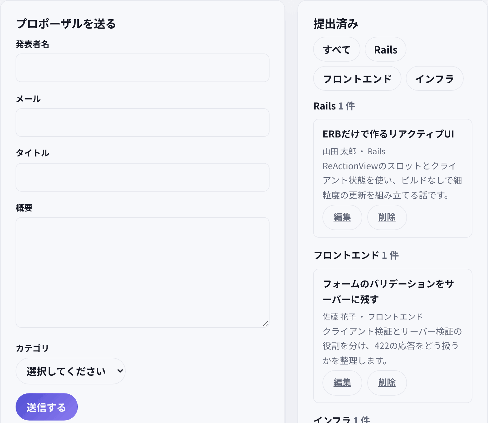

# サーバー検証フォーム（`/forms`） — 標準 Rails の 422 を ReActionView と同居させる

ReActionView 0.6.0 + herb 0.11.1 の検証アプリで、**サーバー検証つきのフォーム**を標準の Rails のまま残せるかを確かめた記録です。画面は `/forms`（ナビ外）。成功はリダイレクト、失敗は 422 の HTML 全画面再描画にし、同じページに client mode のカテゴリ絞り込みを置いています。



## 何を確かめたか

既存の7画面は、クライアント検証（Settings / Client Lab）か楽観的追加（Sprint Hub）で、サーバーが 422 を返す経路を一度も通していませんでした。実務のフォームでは、必須・文字数・メール形式・選択肢の検証をサーバーに置き、失敗時に項目別のエラーを返すのが普通です。

確認したのは次の3点です。

- 標準の `form_with` は、ReActionView のページ内でも通常の POST として動くか。
- 422 の全画面再描画で、エラーと入力値が残るか。
- 同じページの client mode 絞り込みは、フォームの入力値を壊さずに 0 往復で動くか。

## 結論

動きます。フォームを **`data-herb-into` なしの `form_with`** にし、失敗時は `render :index, status: :unprocessable_entity` を返すのが実務での正解です。ブラウザは 422 の HTML を全画面で描き直し、`@proposal.errors` と `@proposal` の値がそのまま出ます。

同じページの絞り込みは client mode の `hidden` presence で動かします。チップの切替は slots リクエスト 0 で、入力途中のフォーム値も変わりません。

## なぜ slots 書き込みではだめか

`data-herb-into` を付けたフォームは、ReActionView の outbox が送信を横取りします。クライアントは応答が 2xx でないと `SlotsRequestError` を投げ、outbox は楽観行に `failed` を立てるだけです。422 の HTML 本文は DOM に適用されず、ブラウザも遷移しません。

```js
// reactionview-0.6.0/app/assets/javascripts/reactionview.esm.js（要約）
if (!response.ok) {
  throw new SlotsRequestError(response.status, body)
}
```

```js
// outbox の失敗処理（要約）
catch (error) {
  this.fail(record) // 楽観行に failed: true を立てるだけ
}
```

つまり、`data-herb-into` を付けたまま `render :new, status: :unprocessable_entity` を返すと、**静かに失敗**します。項目別のエラーは出ず、汎用の `failed` 状態しか残りません。Rails の 422 を活かすなら、フォームを outbox に渡さないことが先決です。

## 実装の形

```erb
<%= form_with model: @proposal, url: forms_path,
  class: "proposal-form", html: { novalidate: true } do |form| %>
  <% if @proposal.errors.any? %>
    <div class="form-errors" role="alert">
      <p><%= @proposal.errors.count %> 件の入力エラーがあります</p>
      <ul>
        <% @proposal.errors.full_messages.each do |message| %>
          <li><%= message %></li>
        <% end %>
      </ul>
    </div>
  <% end %>
  ...
<% end %>
```

```ruby
def create
  @proposal = Proposal.new(proposal_params)

  if @proposal.save
    redirect_to forms_path, notice: "プロポーザルを送信しました"
  else
    @proposals = Proposal.order(created_at: :desc).group_by(&:category)
    render :index, status: :unprocessable_entity
  end
end
```

- `novalidate` は実測で必要になりました。`form.email_field` の `type=email` は、ブラウザが送信前に形式を検証してしまい、`not-an-email` のような値では 422 のリクエスト自体が飛びません。サーバーを唯一の検証者にするため、ブラウザの検証は切ります。
- エラー要約は `role="alert"`、各項目の下に `.field-error` を出します。`aria-invalid` も付けています。
- 入力値は `form_with model: @proposal` が `@proposal` から描くので、422 でも保持されます。
- フォームに `data-herb-into` も `data-herb-set` も付けません。submit を状態に書かせず、二重送信の余地を作りません。
- JavaScript を切っても同じ経路です。フォームは通常の POST、失敗は 422 の HTML、成功はリダイレクトで動きます。

## 同じページの client mode 絞り込み

```erb
<%# herb:slots client %>
<%# herb:state (filter_category: "all") %>

<button class="chip filter-chip" data-herb-set="filter_category=rails"
  aria-pressed="<%= filter_category == "rails" %>">Rails</button>

<section class="proposal-group" data-category="rails"
  hidden="<%= filter_category != "all" && filter_category != "rails" %>">
  ...
</section>
```

- チップは4つ（すべて / Rails / フロントエンド / インフラ）。literal set と literal 比較だけで書く。
- 3つのセクションは常に DOM に置き、`hidden` の presence で出し分ける。分岐は使わない。
- `&&` は `all` の presence 条件としてコンパイルされます。マニフェストの `states.presence` に3つの条件が載り、`states.declarations` は `filter_category` 1つです。
- チップの切替は slots リクエスト 0。フォームの値は state ではなく server-read なので、絞り込みでサーバーに問いに行かず、入力途中の値も上書きされません。
- サーバーは絞り込みを知りません。`@proposals` は全件をカテゴリ別に返し、表示だけクライアントが切り替えます。
- リロードや 422 の後は `filter_category` が `"all"` に戻ります。全画面ナビゲーションなので、これは仕様です。

server mode の絞り込みにしなかったのは、slots 応答がフォームの server-read 値も運ぶためです。入力中に絞り込むと、空の `@proposal` でフォームの値が上書きされる懸念があります。client mode なら往復しないので、この競合自体が起きません。

## 使い分けの判断表

| フォームの性質 | 使う形 | このリポジトリの例 |
|---|---|---|
| 入力に応じた即時フィードバックが主目的 | client mode の派生 state + presence | Settings、Client Lab 機能⑫ |
| 追加が主目的で、失敗は汎用表示でよい | `data-herb-into` の 201 splice + `failed` state | Sprint Hub の楽観的追加 |
| サーバー検証の項目別エラーが必要 | `data-herb-into` なしの標準フォーム + 422 HTML | `/forms` |

「slots のまま項目別エラーを出したい」なら、200 の独自 envelope か独自 transport が要ります。どちらもこのページの範囲外です（後述）。

## 実測

ブラウザ実測は `/tmp/opencode/capture/forms-probe.js`（headless Chromium、リポジトリ外）。

| 操作 | document | slots | 結果 |
|---|---|---|---|
| 初期表示 | 1 | 0 | 3セクションが見える。フォームに `data-herb-into` はない |
| Rails チップ | 0 | 0 | Rails だけ表示。入力中のタイトルは保持 |
| 無効送信 | 1（POST） | 0 | 422。エラー要約と項目別エラー。email / title / abstract を保持 |
| 有効送信 | 1（POST）→ 302 → GET | 0 | flash と新しいカード |
| 送信後のチップ | 0 | 0 | 1セクションに絞り込み |

統合テストで固定している応答:

- 無効な HTML POST → `422` / `text/html`。
- 無効な `POST ?format=slots` → `422` / `application/vnd.herb.slots+json`。本文は slots の payload だが、クライアントは `!response.ok` で捨てる。
- マニフェスト: `filter_category` の宣言1つ、`hidden` の presence 3つ、`aria-pressed` の state 比較。

## 制約

- 失敗時は全画面が再描画されます。入力値とエラーは残りますが、スクロール位置と `filter_category` は初期値に戻ります。
- エラーメッセージは Rails 既定の英語です。i18n は今回の対象外です。
- 部分更新のエラー表示はありません。エラーを slots で差し替えるには独自 transport が要ります。
- JavaScript を切ると、フォームは動きますが、client mode の絞り込みは動きません。全セクションが見えたままになります。
- `filter_category` は4つの literal だけをサポートします。`HerbRuntime.state.set` でそれ以外の値を直接入れると、0.6.0 の refetch が走り、表示が一時的に不整合になります。UI はその値を生成しません。

## Why not 200 envelope / custom transport

- **200 envelope**: 422 を 200 に包み、エラーを slots の payload に載せる方法です。クライアントは適用できますが、Rails の status 契約から外れ、HTTP ツールやログから失敗が見えにくくなります。フォームごとに独自の応答形を持つことにもなります。
- **独自 transport**: 422 の HTML を自分で DOM に差し込む、またはエラーを slots に変換する方法です。カスタム JS が必要で、「ERB のみ」というこのリポジトリの主張を弱めます。エラー表示の二重管理にもなります。

標準フォームの 422 は、失敗がそのまま見え、デバッグもブラウザの通常のナビゲーションとして追えます。サーバー検証が主役のフォームでは、この素直さを優先しました。
