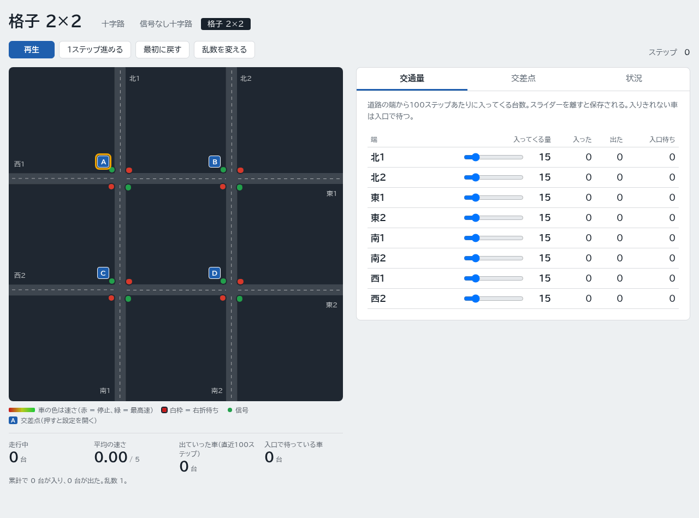
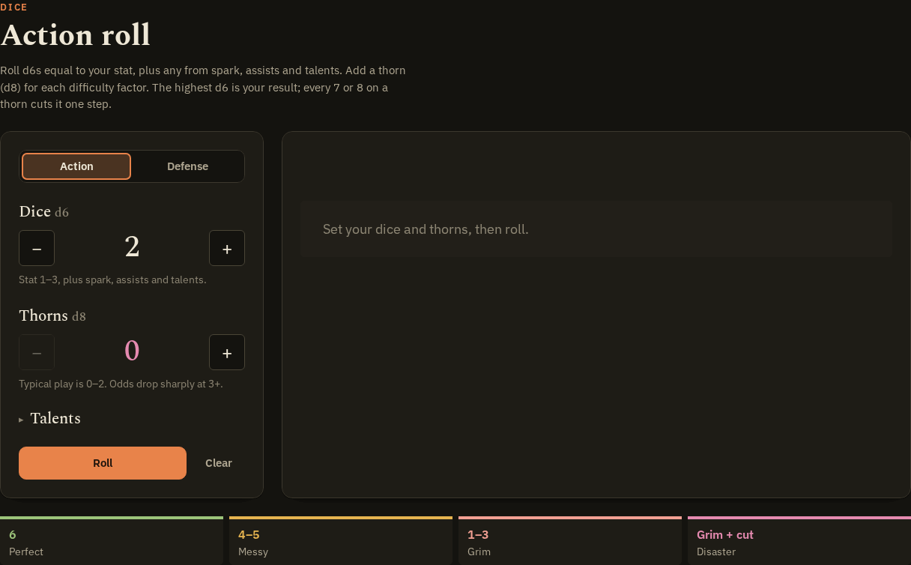
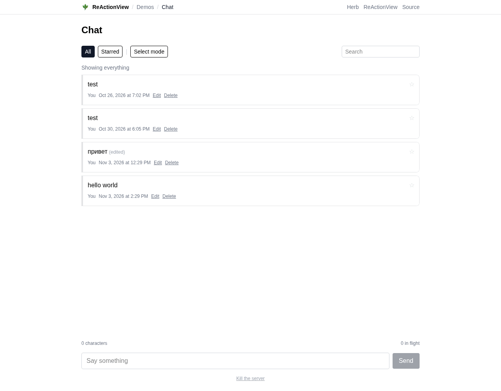
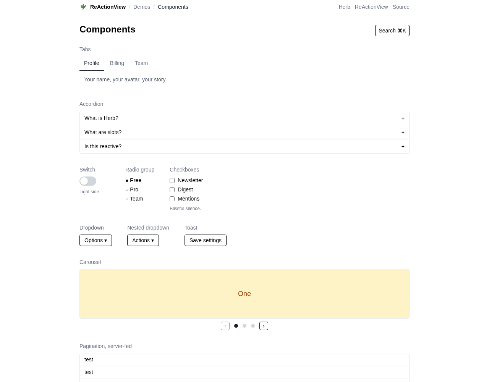
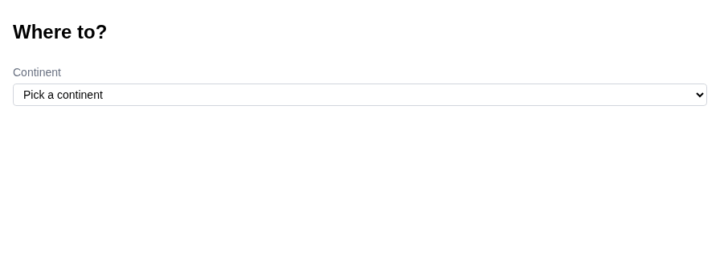
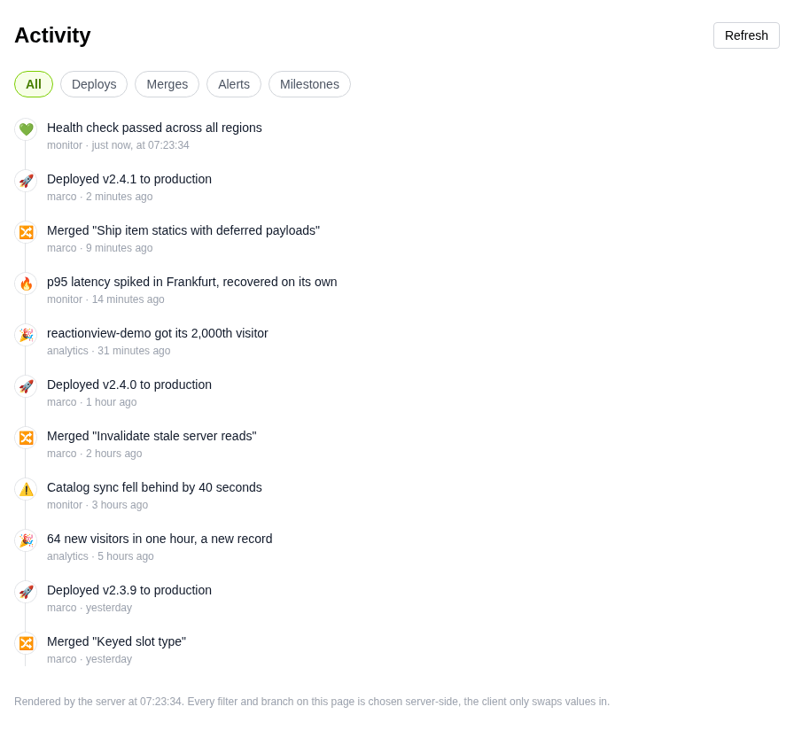

# 他の ReActionView 実装 — 公開実装の調査（2026-11-08）

## 何を調べたか

公式デモ以外に、ReActionView を使っている公開実装がどれだけあるか、どのように使っているかを調べた。対象は GitHub の公開リポジトリと公開記事で、リアクティブテンプレート（`herb:state` / `data-herb-*` / slots）まで使うものと、HTML-aware ERB エンジンとしてだけ使うものに分けた。

調査方法は、GitHub の commit search（Dependabot の bump と、`herb:state` / `data-herb-*` / `herb_state` を含むコミット）、repository search、RubyGems の reverse dependencies、Sourcegraph、Web 検索。GitHub の code search は未認証では使えないため、private repo と、コミットメッセージに手がかりを残していない repo は拾えていない。以下は 2026-11-08 時点の公開情報で、各アプリを起動して性能を測ったものではない。

## 結論

- 公式デモ以外で、リアクティブテンプレートまで使っている公開実装は、今回見つけた中では **5件**。いずれも 2026-10 以降に作られたものだ。
- 本番・公開アプリの多くは、`intercept_erb` で HTML-aware ERB エンジンとして使い、検証・デバッグ・dev tools の範囲に留めている。リアクティブまでは踏み込んでいない。
- 0.6.x の slots は experimental で opt-in なので、この差は自然だ。まずエンジンとして入れ、必要なら `.html.herb` や一部のページだけ slots を試す、という順序が実務的である。
- 本リポジトリは、公式デモを除くと、リアクティブ機能の網羅性では今回見つけた中で最も広い。

## リアクティブ実装

公式デモ（[marcoroth/reactionview-demo](https://github.com/marcoroth/reactionview-demo)、[demo.reactionview.dev](https://demo.reactionview.dev)）は12ページで、Chat / Music / Components / Activity / Cascade / Deferred など、パターンのカタログになっている。以下はそれ以外の5件。

| リポジトリ | モード | 内容 | 最終更新 |
|---|---|---|---|
| [h-kono-it/rails-herb](https://github.com/h-kono-it/rails-herb) | server | 交通シミュレーション。重い計算をキャッシュし、state はクエリキーに使う | 2026-10-19 |
| [phChun/grimwilder](https://github.com/phChun/grimwilder) | client | テーブルトップRPGのダイスツール。Stimulus の `useState` と state machine | 2026-11-05 |
| [Martin-Business-Consultants/runwellv2](https://github.com/Martin-Business-Consultants/runwellv2) | client | プロジェクト管理プロダクト。partial 単位の state と `hidden` | 2026-11-08 |
| [innocentdiaz/claims](https://github.com/innocentdiaz/claims) | client | 小規模な claims アプリ。`.html.herb` だけの漸進導入 | 2026-10-16 |
| [HuzaifaSaifuddin/reactionview-demo](https://github.com/HuzaifaSaifuddin/reactionview-demo) | server | 公式 Quick Start の messages デモ | 2026-10-25 |

### h-kono-it/rails-herb — server mode の実例

ReActionView 0.6.0 / Herb 0.11.0 / Rails 8.1.4 / Ruby 3.4.11。`config.slots = true` とし、画面は `<%# herb:slots server %>` で動かす。state は `step` / `junction` / `panel` / `slowdown` / `seed` / `playing` だけで、すべてスカラーだ。



この撮影では、1ステップ×3、再生、交差点の選択、状況タブ、減速スライダーで **17回の slots 要求** が飛んだ。state は小さいが、サーバー側のシミュレーションとキャッシュが効いている。撮影は、README が前提にする Ruby 3.4.11 ではなく、この環境の Ruby 4.0.9 で起動して行った。

コントローラーは state をクエリキーとして読む（[networks_controller.rb](https://github.com/h-kono-it/rails-herb/blob/main/app/controllers/networks_controller.rb)）。

```ruby
@step = [herb_state("step", 0).to_i, 0].max
@simulation = advance(
  graph: @network.graph,
  slowdown: herb_state("slowdown", 15).to_i / 100.0,
  seed: herb_state("seed", 1).to_i
)
```

シミュレーション本体は state に載せず、`Rails.cache` に network + seed 単位で置き、前回の step から進める。state は「どこまで進んだか」だけを持つ。

```ruby
key = [ "networks", @network.id, "run", seed ]
run = Rails.cache.read(key)
run = run&.reconfigure(graph:, slowdown:) || Simulation.new(graph:, slowdown:, seed:)
run.run(@step - run.time)
Rails.cache.write(key, run, expires_in: 1.hour)
```

UI 側の良いところ（[networks/show.html.erb](https://github.com/h-kono-it/rails-herb/blob/main/app/views/networks/show.html.erb)）:

```erb
<button type="button" data-herb-increment="step">1ステップ</button>
<button type="button" data-herb-toggle="playing">再生</button>
<input type="range" data-herb-set="slowdown=$value">
<button type="button" data-herb-set="junction=<%= node.id %> panel=junction">
```

- **複数 state を1操作で変える**: `junction=... panel=junction` で「交差点を選ぶ＋タブを開く」を同時に行う。
- **state 比較は literal のみ**なので、ループ内の `aria-pressed` は state ではなくサーバー側の ivar `selected` と比較する: `aria-pressed="<%= node == selected %>"`。
- **`herb:key` はループ直下**。`if` の中に入れない。
- **動的に増える車は SVG でなく HTML**。クライアントが行を HTML で構築するため、SVG の名前空間では追加分が描画されない。
- **server read を意図的に作る**にはヘルパー経由で読む:

```erb
<dd><%= number_with_delimiter(step) %></dd> <%# herb:disable herb-state-valid-reads %>
```

`<%= step %>` だけだとクライアントが評価できてしまい、サーバーに問い合わせない。ヘルパーを通すことで「サーバーで再計算したい state」であることを強制する。

- **DB に保存する設定は state にしない**。スライダーは [autosave_controller.js](https://github.com/h-kono-it/rails-herb/blob/main/app/javascript/controllers/autosave_controller.js) が PATCH し、成功後に `Runtime.get().refresh()` で再描画する。

```js
await fetch(url, { method: "PATCH", body, headers: ... })
if (response.ok) Runtime.get()?.refresh()
```

[docs/development.md](https://github.com/h-kono-it/rails-herb/blob/main/docs/development.md) には、この repo で踏んだ落とし穴がまとまっている。client-evaluable read、`herb:key` の位置、SVG、`stylesheet_link_tag :app`、Turbo 後の `useState` のタイミングなど、本リポジトリの `AGENTS.md` と重なる内容が多い。

**注意点**: オートプレイは既定 250ms ごとに `state.increment("step")` する（[autoplay_controller.js](https://github.com/h-kono-it/rails-herb/blob/main/app/javascript/controllers/autoplay_controller.js)）。server mode ではリクエスト頻度が高くなり得るので、実運用なら間隔・合流・キャッシュを測る。

### phChun/grimwilder — client mode + Stimulus の分離

ReActionView 0.6.0 / Rails 8.2 main / Ruby 4.0.9。`config.slots = true` とし、画面は `<%# herb:slots client %>`。state はすべてプリミティブだ（[rolls/show.html.erb](https://github.com/phChun/grimwilder/blob/main/app/views/rolls/show.html.erb)）。

```erb
<%# herb:state (stat: 2, thorns: 0, mode: "action", outcome: "", critical: false,
                 assists: 0, panache: 0, reckless: false, teamwork: false,
                 spell: false, twist: false) %>
```



この撮影では、ダイス6個・thorn 2個に増やし、Defense に切り替えて2回振った。ダイスの出目と結果の分岐はすべてクライアントで完結し、**slots 要求は0**だった。GIF は公開中の [grimwilder.com/roll](https://grimwilder.com/roll) で撮った。

テンプレートが state を持ち、Stimulus は「読む・計算する・書き戻す」だけを担当する（[roller_controller.js](https://github.com/phChun/grimwilder/blob/main/app/javascript/controllers/roller_controller.js)）。

```js
import { useState } from "reactionview"

connect() { useState(this) }

roll() {
  const get = (name) => this.state.get(name)
  const result = talentRoll({ dice: get("stat"), thorns: get("thorns"), ... })
  this.drawTray(result)
  this.state.set({ outcome: result.result, critical: result.critical, twist: result.twist })
}
```

テンプレート側は `case outcome` で結果文言を切り替えるだけ。**純粋な UI 計算はクライアント、state はテンプレート**という分担がきれいだ。

- **非同期フローの state machine**: `passkey_status` を `idle` → `waiting` → `verifying` → `unsupported` と動かし、テンプレートは `case` でメッセージを出す（[passkey_controller.js](https://github.com/phChun/grimwilder/blob/main/app/javascript/controllers/passkey_controller.js)）。
- **一時的な state**: `copied` を true にして2秒後に false に戻す（[clipboard_controller.js](https://github.com/phChun/grimwilder/blob/main/app/javascript/controllers/clipboard_controller.js)）。
- **1つの state に複数コントロールを同期**: `new_size` を radio のプリセットと number input の両方にバインドする（[pools/_form.html.erb](https://github.com/phChun/grimwilder/blob/main/app/views/campaigns/pools/_form.html.erb)）。
- **radio を使う理由**: `aria-pressed="<%= option == value %>"` のような「ループデータとの比較」はできないため、[shared/_segmented.html.erb](https://github.com/phChun/grimwilder/blob/main/app/views/shared/_segmented.html.erb) は radio input にしている。

**注意点**: client mode は分岐の statics を全部積むので、分岐が大きいと HTML が増える。また partial 内の分岐は 0.6.0 で materialize されないことがあるため、Grimwilder は結果分岐を full-page テンプレートに置いている。

### Martin-Business-Consultants/runwellv2 — partial 単位の client mode

公開プロダクトのコード。ReActionView 0.6.0。partial に `herb:state` を置き、**partial ごとに state を閉じる**のが特徴だ（[works/_close.html.erb](https://github.com/Martin-Business-Consultants/runwellv2/blob/main/app/views/works/_close.html.erb)）。

```erb
<%# herb:slots client %>
<%# herb:state (confirming: false) %>

<button type="button" data-herb-toggle="confirming" hidden="<%= confirming %>">Delete</button>
<div hidden="<%= !confirming %>">...確認フォーム...</div>
```

**分岐ではなく `hidden` の presence** で、両方の UI を最初から DOM に置く。コメントにも「opening them never waits on the server」とある。partial 内の分岐が materialize されない 0.6.0 のギャップを避けつつ、開閉を即時にする実務的な形だ。

`closing` のように3値を持つ state も、3つの `hidden` セクションで表現する。

```erb
<%# herb:state (closing: "") %>
<div hidden="<%= closing != "" %>">選択肢</div>
<div hidden="<%= closing != "completed" %>">完了フォーム</div>
<div hidden="<%= closing != "cancelled" %>">キャンセルフォーム</div>
```

`state-focus` という小さな Stimulus controller で、state が変わったときに `autofocus` フィールドへフォーカスを移す（[state_focus_controller.js](https://github.com/Martin-Business-Consultants/runwellv2/blob/main/app/javascript/controllers/state_focus_controller.js)）。

```js
connect() {
  useState(this)
  this.stopListening = this.state.on(this.stateValue, () => requestAnimationFrame(() => this.#focus()))
}
```

`hidden` で開いたフォームの使い勝手を左右する、地味だが良いパターンだ。

また、engine の partial に slots resolver が付かない問題に対して、初期化子で patch を入れている（[config/initializers/reactionview.rb](https://github.com/Martin-Business-Consultants/runwellv2/blob/main/config/initializers/reactionview.rb)）。

```ruby
engine.paths["app/views"].existent.each { prepend_view_path ReActionView::Slots::Resolver.new(it) }
```

これは 0.6.0 の制約に対するワークアラウンドなので、engine/plugin の partial を使うときに必要になる、と覚えておくのがよい。

Runwell は公開デモがないため、この節はコードのみ。同じ `hidden` の形は、下の「良い使い方」の Chat GIF で確認できる。

### innocentdiaz/claims — `.html.herb` だけの漸進導入

`config.slots = :client`、`intercept_erb` は commented のまま。**`.html.herb` の4ファイルだけ**を reactive にしている（[config/initializers/reactionview.rb](https://github.com/innocentdiaz/claims/blob/main/config/initializers/reactionview.rb)）。

```erb
<%# herb:state (body: "") %>
<textarea name="item[description]" data-herb-set="body=$value"></textarea>
<p>
  <span><%= Item.category_label(body) %></span>
  <span><%= body.length %>/<%= Item::DESCRIPTION_LIMIT %></span>
</p>
```

テキストはクライアント state、文字数は `.length` でクライアント評価。`Item.category_label(body)` と `Claim.specificity_label(story)` は **サーバー読み**で、`S1::Measurable` の分類・測定を呼ぶ（[app/models/item.rb](https://github.com/innocentdiaz/claims/blob/main/app/models/item.rb)）。つまり「入力はクライアント、分類ラベルはサーバー」という分担だ。

**良い点**: すべての ERB を intercept せず、必要なページだけ `.html.herb` で試せる。保存は通常の form POST で、outbox や 422 の複雑さを持ち込んでいない。

**注意点**: 分類・測定が keystroke ごとに走るならコストが大きい。実運用なら debounce/throttle、blur/submit 時だけ、などの調整が要る。このアプリは小規模デモなので、そのまま本番テンプレートにはしない方がよい。

### HuzaifaSaifuddin/reactionview-demo — 最小の server mode

公式 Quick Start と同じ messages デモ。ReActionView 0.6.0、`config.slots = true`、`herb:slots server`（[messages/index.html.erb](https://github.com/HuzaifaSaifuddin/reactionview-demo/blob/main/app/views/messages/index.html.erb)）。

```erb
<%# herb:slots server %>
<%# herb:state (composing: false, order: "oldest") %>

<select data-herb-set="order=$value">...</select>
<% if order == "newest" %>Newest messages first<% else %>Oldest messages first<% end %>
<button data-herb-toggle="composing">New message</button>
```

コントローラーは `Message.all` だけで、並べ替えはビューの helper `messages_in_order(messages, order)` が担当している。**ビュー内の並べ替えなら、コントローラーで `herb_state` を読まなくても動く**という最小例だ。DB クエリに state を使うなら、h-kono や Quick Start のようにコントローラーで `herb_state` を読む。

### 公式デモ — パターンのカタログ

公式 `marcoroth/reactionview-demo` は、良い使い方のカタログになっている。ここで挙げたパターンのうち、Chat / Components / Activity / Cascade の GIF は、下の「良い使い方」に置いた。

- **Chat**: 行ごとの state（`pending` / `failed` / `editing` / `starred` / `confirming` / `selected` / `body_draft`）、カウント fold、`data-herb-name`、`data-herb-into`
- **Music**: アルバムカードで複数 state を一括セット、`<Fragment>` + `<Fallback>` で詳細を遅延、`data-herb-transition`
- **Components**: tabs / accordion / switch / radio / checkbox / dropdown / nested dropdown / palette / carousel / pagination。`data-herb-set` の複数代入、`data-herb-throttle="400"`、`data-herb-increment` / `decrement`
- **Activity**: server mode のフィルタ。`filter` state をサーバーが読み、`$refresh` で更新
- **Status**: client mode だが値はサーバー読み。`data-herb-action="change->$refresh"` で最新値を取り直す
- **Cascade**: 依存 select。`change->country='' change->state=''` で子 state をリセットし、選択肢はサーバーが描画
- **Tooltips**: hover を state に。クライアントツールチップと、サーバー読みの hovercard を `<Fragment>` で
- **Overlays / Drawers / Toasts**: すべて state で開閉。moly-ui の behavior は `data-moly-drawer-state="panel"` のように **state を属性で受け取る**
- **Deferred**: `<Async>` / `<Lazy>` + `<Fallback>`

## 良い使い方（横断）

GIF は、公開されている Grimwilder と公式デモ、ローカルで起動した h-kono から撮った。Runwell と Claims は公開デモがないためコードのみで、同じ形を公式デモの GIF で補っている。

1. **state はブラウザ所有の UI、データはサーバー**
   - h-kono は step/seed/slowdown だけを state にし、シミュレーションはキャッシュする。
   - Grimwilder はダイスの出目だけを state にし、計算は JS で行う。
   - DB の一覧・集計・分類は state に載せない。

2. **モードはページ単位で選ぶ**
   - DB クエリ・集計・フィルタ → server mode（Activity、h-kono、Huzaifa）。
   - 自己完結した UI → client mode（Grimwilder、Runwell、Music、Components）。
   - 同じアプリ内で混在してよい。

3. **小さな開閉は `hidden`、大きな切替は分岐**
   - Runwell は partial 内の開閉をすべて `hidden` で表現する。即時で、partial の分岐ギャップも踏まない。
   - 公式 Music の詳細や Components のタブは分岐。ただし full-page テンプレート側に置く。
   - 両方の UI を DOM に置くコストと、往復のコストを天秤にかける。



この撮影では、Starred の空状態から All に戻し、Select mode で行を選択、Select all で件数を出し、削除確認を開いてキャンセルした。行ごとの `selected` と `selected_count` はクライアントで更新され、**slots 要求は0**だった。

4. **`data-herb-set` で複数 state を同時に変える**
   - `junction=3 panel=junction`
   - `menu=false toast='Renamed it for you'`
   - `change->country='' change->state=''`
   - 中間状態を見せない、リクエストを分けない。



この撮影では、Billing タブ、アコーディオン、スイッチ、Options → Copy → トーストの順に操作した。`menu=false toast='Copied to clipboard'` は1つの `data-herb-set` で同時に書き、トーストの × は `data-herb-reset="toast"` で消している。Billing タブの `Message.count` だけはサーバー読みなので、タブを開いたときに1回だけ slots 要求が飛んだ。**client mode でもサーバー読みは往復する**例だ。



この撮影では、Europe → Switzerland → Basel-Stadt と選び、最後に「You could live in Basel, Riehen or Bettingen」が出た。依存する選択肢はサーバーが描画し、子 state は `change->country='' change->state=''` でリセットされる。各選択で slots 1回（合計3回）だった。

5. **`data-herb-reset` をキャンセル/クリアに使う**
   - Runwell の Cancel / Esc、公式 Chat の下書きクリア、h-kono の step リセット。
   - Components GIF のトースト × が `data-herb-reset` の例。

6. **server mode では「サーバー読み」を意図的に作る**
   - `<%= number_with_delimiter(step) %>` + `herb:disable herb-state-valid-reads`
   - クライアント評価できる読み方のままだと、state を変えてもサーバーに問い合わせない。

7. **`$refresh` は「state ではないサーバー値」に使う**
   - Activity の Refresh、Status の期間切替、h-kono の設定保存後。
   - 1ジェスチャー1回に抑える。複数のサーバー読みを別々の分岐に置くと往復が増える。



この撮影では、Deploys → Alerts → All → Refresh の4操作で slots 要求が4回、ちょうど1操作1回だった。フィードの内容と「Rendered by the server at ...」の時刻は、サーバーが返した値で更新されている。

8. **コレクションは `herb:key`、カウントはループ後に fold**
   - `herb:key` はループ直下。`if` の中に入れない。
   - カウントは3タグの `<% if done %><% count += 1 %><% end %>` をキー付き item 内に置き、読みはリストの後。
   - 公式 Chat と h-kono の両方で徹底されている。
   - 上の Chat GIF の選択モードが、行ごとの `selected` と `selected_count` の fold を示している。

9. **`data-herb-name` は楽観行・差し替え行に**
   - 公式 Chat の `data-herb-name="body"`、本リポジトリの Outbox の `title`。
   - サーバー検証が主役のフォームは `data-herb-into` に載せず、標準 form + 422 に任せる（Claims もこの形）。

10. **`useState` は「JS の振る舞い」に使い、データ取得に使わない**
    - Grimwilder のダイス・パスキー・クリップボード。
    - Runwell のフォーカス。
    - h-kono のオートプレイ・オートセーブ。
    - テンプレートが state を持ち、JS は読み書きだけする分担がきれい。
    - 上の Grimwilder GIF が、`useState` でテンプレートの state を読み書きする例。

11. **state は partial / component のローカルに閉じる**
    - Runwell は partial ごとに `herb:state`。名前衝突を避け、再利用しやすい。
    - Poetry もコンポーネント単位で slots をテストしている。
    - 逆に、同じ state 名をテンプレートをまたいで使うと衝突する（本リポジトリの Tree の実測どおり）。
    - Components GIF のアコーディオンは、行ごとの `open` state が独立している例。

12. **漸進導入と安全策**
    - `.html.herb` だけ reactive にする（Claims）。
    - 本番は `validation_mode: :none`、開発だけ overlay（irida-next、lead-intelligence のテンプレート）。
    - gem を dev/test だけに入れるなら initializer を guard する（JuanVqz の記事）。
    - engine のテンプレートを slots でコンパイルするなら `external_template_mode = :compile`（Poetry）。

## エンジンとしての採用

リアクティブまでは使わず、`intercept_erb = true` で HTML-aware ERB エンジンとして使っている主なアプリ。

| リポジトリ | 内容 | ReActionView | 設定 |
|---|---|---|---|
| [phac-nml/irida-next](https://github.com/phac-nml/irida-next) | ゲノム解析プラットフォーム | 0.6.0 | 全環境で `intercept_erb`、production は `validation_mode: :none` |
| [bikeindex/bike_index](https://github.com/bikeindex/bike_index) | 自転車登録 | 0.6.0 | 全環境で `intercept_erb` |
| [rubyevents/rubyevents](https://github.com/rubyevents/rubyevents) | Ruby イベント情報 | 0.6.1 | 全環境で `intercept_erb` |
| [kaigionrails/conference-app](https://github.com/kaigionrails/conference-app) | Kaigi on Rails 公式アプリ | 0.6.0 | 全環境で `intercept_erb` |
| [rubyapi/rubyapi](https://github.com/rubyapi/rubyapi) | Ruby API ドキュメント | 0.6.0 | 全環境で `intercept_erb` |
| [indirect/feedyour.email](https://github.com/indirect/feedyour.email) | メールフィード | 0.6.0 | 全環境で `intercept_erb` |
| [armandmgt/velo](https://github.com/armandmgt/velo) | Rails アプリ | 0.6.0 | 全環境で `intercept_erb` |
| [t27duck/mallard](https://github.com/t27duck/mallard) | Rails アプリ | 0.6.0 | 全環境で `intercept_erb` |
| [t27duck/t27ducksite](https://github.com/t27duck/t27ducksite) | 個人サイト | 0.6.0 | 全環境で `intercept_erb` |
| [stadia/ruby-news](https://github.com/stadia/ruby-news) | Ruby News | 0.6.0 | 全環境で `intercept_erb` |
| [unasuke/draft-chamber](https://github.com/unasuke/draft-chamber) | Rails アプリ | 0.6.0 | 全環境で `intercept_erb` |
| [georgebaskervil/geor.me](https://github.com/georgebaskervil/geor.me) | 個人サイト | 0.6.0 | 全環境で `intercept_erb` |
| [ChaelCodes/MeetAnotherDay](https://github.com/ChaelCodes/MeetAnotherDay) | Rails アプリ | 0.1.2 | 全環境で `intercept_erb` |
| [kozy4324/blog-app](https://github.com/kozy4324/blog-app) | ブログ | 0.2.2 | 全環境で `intercept_erb` |
| [fbatista/canivete](https://github.com/fbatista/canivete) | Rails アプリ | 0.4.0 | 全環境で `intercept_erb` |
| [unasuke/mcp-coderunner-app](https://github.com/unasuke/mcp-coderunner-app) | MCP アプリ | 0.6.0 | 全環境で `intercept_erb` |
| [rubyforgood/community_foundation](https://github.com/rubyforgood/community_foundation) | 非営利団体のアプリ | 0.4.0 | 全環境で `intercept_erb` |
| [rubyforgood/skillrx](https://github.com/rubyforgood/skillrx) | 非営利団体のアプリ | 0.3.0 | 全環境で `intercept_erb` |
| [miharekar/visualizer](https://github.com/miharekar/visualizer) | 可視化アプリ | 0.6.0 | `intercept_erb = true`、`slots = false` |
| [substancelab/rails-boilerplate](https://github.com/substancelab/rails-boilerplate) | ボイラープレート | 0.6.0 | 全環境で `intercept_erb` |
| [lead-intelligence/rails-template](https://github.com/lead-intelligence/rails-template) | テンプレート | 0.6.0 | 全環境で `intercept_erb`、production は validation なし |

**開発環境だけ**のもの:

- [DFE-Digital/claim-additional-payments-for-teaching](https://github.com/DFE-Digital/claim-additional-payments-for-teaching) — 0.3.0。`DEBUG_VIEW` があるときだけ `intercept_erb`。
- [scmmishra/picoletter](https://github.com/scmmishra/picoletter) — 0.2.1。development のみ。
- [marcoroth/gem.sh](https://github.com/marcoroth/gem.sh) — 0.1.5。development のみ。

**Gemfile にはあるが、まだ有効化していない**もの:

- [csa-admin-org/csa-admin](https://github.com/csa-admin-org/csa-admin) — `intercept_erb` は commented、`.html.herb` もなし。
- [demarche-numerique/demarche.numerique.gouv.fr](https://github.com/demarche-numerique/demarche.numerique.gouv.fr) — 同上。
- [ideasasylum/wombatworkouts](https://github.com/ideasasylum/wombatworkouts) — `intercept_erb = false`、`.html.herb` もなし。

**テンプレート**:

- [radanskoric/rails_app_template](https://github.com/radanskoric/rails_app_template)、[hschne/kalamazoo](https://github.com/hschne/kalamazoo)、[iachettifederico/rails-starter-template](https://github.com/iachettifederico/rails-starter-template)、[mattfeg/ferreira-rails-template](https://github.com/mattfeg/ferreira-rails-template) は、生成するアプリに ReActionView を入れる。

## エコシステム

- [roboruby/poetry](https://github.com/roboruby/poetry) — 88コンポーネントの Rails UI ライブラリ。dummy app を `:engine` / `:server` / `:client` の3モードで回し、slots 有効時の互換性をテストしている（[dummy config](https://github.com/roboruby/poetry/blob/main/gems/poetry-charts/test/dummy/config/reactionview.rb)）。`useState` と `data-herb-*` をコンポーネントと組み合わせる方法も docs にある（[herb.html.erb](https://github.com/roboruby/poetry/blob/main/gems/poetry-docs/app/views/poetry/docs/docs/herb.html.erb)）。
- [ViewComponent/view_component](https://github.com/ViewComponent/view_component) — CI の Rails 7.1〜main のマトリクスに `reactionview` を追加して互換性を検証している（[Gemfile](https://github.com/ViewComponent/view_component/blob/main/Gemfile)）。
- [lostcoords/tensaku](https://github.com/lostcoords/tensaku) — 開発中のページ上でテキストを直すツール。ReActionView の上に構築されている（[docs](https://tensaku.lostcoords.com)）。RubyGems の reverse dependency は 2026-11-08 時点でこれ1つだけ。
- [ceritium/hamlherb](https://github.com/ceritium/hamlherb) — Haml を Herb AST / ERB に変換し、ReActionView でコンパイルできるようにするツール。

## 記事

- [STORES Product Blog（2026-05-29）](https://product.st.inc/entry/2026/05/29/191707) — 214ファイル / 13,500行の Haml を ERB に移行し、ReActionView を本番のレンダリングエンジンに採用した。エンジン + Herb Linter の話。
- [timedia.co.jp（2025-12-11）](https://www.timedia.co.jp/tech/20251211-tech/) — Rails Tutorial のサンプルアプリに ReActionView を入れて、debug tools / error page を確認した。
- [JuanVqz（2026-11-03）](https://www.juanvasquez.dev/blog/installing-reactionview-and-what-the-herb-linter-found/) — dev/test グループで ReActionView を導入し、Herb Linter が見つけた問題を整理した。
- [FastRuby（2026-09-29）](https://www.fastruby.io/blog/reactionview-and-herb-in-rails-8-2.html) / [SupeRails（2026-10-16）](https://blog.superails.com/rails-world-2026-herb-in-rails-8-2-your-erb-views-now-html-aware) — Rails World 2026 の talk 解説。実装ではないが、0.6.0 の位置づけが分かる。

## 制約と注意

- 今回は**ソースコードを読んだ調査**で、各アプリを実際に起動して性能を測ったわけではない。
- 0.6.x は experimental なので、`hidden` 多用や resolver patch のようないくつかのパターンは「0.6.x の制約に対するワークアラウンド」だ。将来のバージョンで不要になる可能性がある。
- 特に `number_with_delimiter` でサーバー読みを強制する技、partial 内の分岐を避ける `hidden`、engine partial の resolver patch は、制約を知った上で使う。
- 公開リポジトリの調査なので、private repo と、コミットメッセージに手がかりを残していない repo は含まれていない。リアクティブ実装は他にもある可能性がある。
