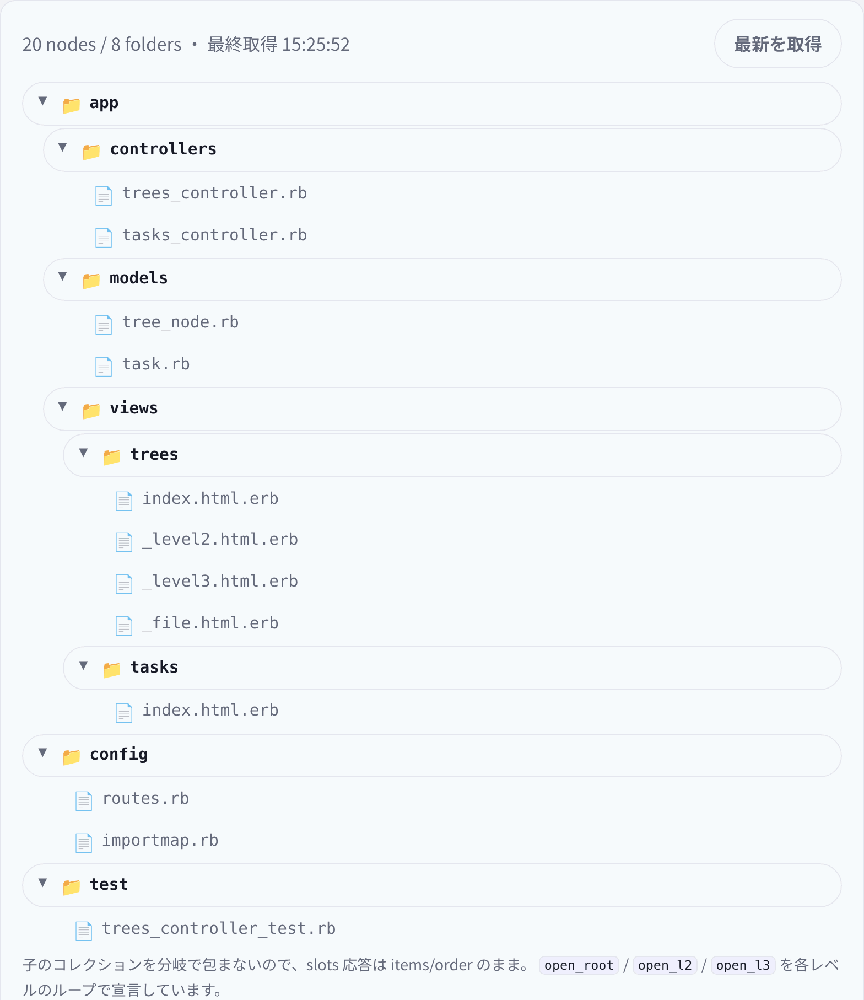

# 深いツリー（`/tree`） — 深さ2+の per-node state

ReActionView 0.6.0 + herb 0.11.1 の検証アプリで、**4階層のファイルツリー**を描き、深さ2以上の入れ子でノードごとの開閉 state がどこまで独立するかを測った記録です。画面は `/tree`（ナビ外）。開閉は client mode で 0 往復、`最新を取得` の slots 1回で `loaded_at` とツリーのキー付き差分が返ります。



## 何を確かめたか

- 深さ2以上の入れ子で、ノードごとの `open` state が独立して動くか。
- フォルダの開閉が **0 slots リクエスト**で動くか。
- `$refresh` の slots 応答で、深い入れ子のキー付き差分が適用されるか。開閉状態が残るか。
- no-JS で初期ツリーが読めるか。

## 結論

**開閉はレベル1/2/3のどこでも 0 slots で動き、状態は独立します。** `$refresh` は slots 1回で `loaded_at` を更新し、閉じていたフォルダの状態も残りました（`refreshKeptState: true`）。no-JS でも20ノードが全開で読めます。

ただし、**素直な再帰 partial では成立しません。** 実装中に次の3つの制約に当たり、最終的には設計のフォールバック（レベル別テンプレート）を採用しました。

1. **per-item state を partial のローカルとして渡せない。** `render "folder", open: open` は `computes with the state open, which lives on an item. The server cannot be asked for an item's answer yet` で `ActionView::SyntaxErrorInTemplate` になります。
2. **partial に置いた `herb:state` は、その partial の全インスタンスで共有される。** `_folder` partial の先頭に `open` を宣言して再帰させると、`views` をクリックしても `app` が閉じました。UI Kit の switch はトップレベルの2インスタンスを occurrence index で分けますが、再帰 partial の state はノードごとには分かれません。
3. **同名の state はテンプレートをまたいで衝突する。** `open` を root / level2 / level3 で宣言すると、どのトグルも root の state を動かしました。`open_root` / `open_l2` / `open_l3` に分けると、各レベルが独立しました。

この3つを避けるため、**state は `herb:key` と同じループの中で宣言し、state を使うボタンと `hidden` も同じテンプレートに置く**形にしました。子のコレクションを `if children.any?` で包まないことも必須です。分岐で包むと slots 応答が items/order ではなく branch statics になり、キー付き差分が壊れます。

## データ

- `TreeNode`（`tree_nodes`）: `name:string`、`kind:string`（`folder` / `file`）、`parent_id:integer`（自己参照）、`position:integer`。
- `belongs_to :parent` / `has_many :children`（`dependent: :destroy`）。`scope :ordered`。
- seed は20ノード・8フォルダ・12ファイル。fixture は10ノード・4階層。
- `TreesController#index` は全ノードを1回読み、`@children_by_parent = nodes.group_by(&:parent_id)` で平坦な配列からツリーを組みます。ノードごとの `children` 取得はしません。

## 実装

```
app/views/trees/
  index.html.erb   # レベル1（root）のループ
  _level2.html.erb # レベル2のループ
  _level3.html.erb # レベル3のループ＋レベル4のファイル
  _file.html.erb   # ファイル行（state なし）
```

レベル1のループ:

```erb
<% @roots.each do |root| %>
  <%# herb:key root.id %>
  <%# herb:state (open_root: true) %>
  <li class="tree-node tree-<%= root.kind %>">
    <% if root.kind == "folder" %>
      <button class="tree-toggle" data-herb-toggle="open_root" aria-expanded="<%= open_root %>">…</button>
    <% else %>
      <%= render "file", node: root %>
    <% end %>

    <ul class="tree-children" hidden="<%= !open_root %>">
      <%= render "level2",
        nodes: @children_by_parent[root.id] || [],
        children_by_parent: @children_by_parent %>
    </ul>
  </li>
<% end %>
```

レベル2も同じ形で、state 名だけ `open_l2` にします。

```erb
<% nodes.each do |node| %>
  <%# herb:key node.id %>
  <%# herb:state (open_l2: true) %>
  ...
  <button class="tree-toggle" data-herb-toggle="open_l2" aria-expanded="<%= open_l2 %>">…</button>
  ...
  <ul class="tree-children" hidden="<%= !open_l2 %>">
    <%= render "level3",
      nodes: children_by_parent[node.id] || [],
      children_by_parent: children_by_parent %>
  </ul>
<% end %>
```

- 子のコレクション（`_level2` / `_level3`）は `<ul>` の中にあり、`if node.kind == "folder"` の外に置いています。`kind` の分岐は行の見た目だけを切り替えます。
- レベル4のファイルは `_level3` の中で `herb:key` 付きで描きます。レベル4のフォルダは対象外です（4階層で止める設計）。
- 空のフォルダは空の `<ul class="tree-children">` を出し、CSS の `.tree-children:not(:has(> li)) { display: none; }` で見せません。ERB の空白テキストがあるため `:empty` は使えません。
- `aria-expanded="<%= open_root %>"` は "true"/"false" の文字列補間です。client mode ではクライアントが評価します。
- `hidden="<%= !open_root %>"` は presence バインディングです。

## 実測

ブラウザ実測は `/tmp/opencode/capture/tree-probe.js`（headless Chromium、リポジトリ外）。

| 操作 | slots | 結果 |
|---|---|---|
| 初期表示 | 0 | 20ノード / 8フォルダ / 12ファイル、全開 |
| レベル1（`app`）を閉じる / 開く | 0 / 0 | 子が隠れる / 戻る、`aria-expanded` が追随 |
| レベル2（`views`）を閉じる / 開く | 0 / 0 | 孫が隠れる / 戻る |
| レベル3（`trees`）を閉じる / 開く | 0 / 0 | ひ孫が隠れる / 戻る |
| 兄弟の独立 | 0 | `trees` を閉じても `tasks` は開いたまま、`views` を閉じても `models` は開いたまま |
| `最新を取得` | 1 | `loaded_at` が変わる。閉じていた `trees` は閉じたまま（state 生存） |
| リロード | 0（document） | 全開に戻る |
| no-JS | 0 | 20ノードが全開で読める。開閉は動かない |

プローブの要約は `initialSlots: 0`、`level1Slots: 0`、`level2Slots: 0`、`level3Slots: 0`、`independent: true`、`emptyListHidden: true`、`refreshSlots: 1`、`refreshKeptState: true`、`reloadOpensAll: true`、`noJsReadsAll: true`、`declarations: ["open_l3", "open_l2", "open_root"]`、`presence: ["open_l3", "open_l2", "open_root"]`、`pageErrors: []` です。

`$refresh` の slots 応答では、`loaded_at` の READ slot とツリーの `items` / `order` が返ります。`child.kind` の分岐は行の見た目だけで、コレクションを包んでいないため、余分な branch refetch は発生しませんでした（1リクエスト）。

## テスト環境の注意

`aria-expanded="<%= open_root %>"` はコレクション内の動的属性で、`data-herb-slot="…:attribute:aria-expanded"` のマーカーが付きます。初期値はテスト環境でも `aria-expanded="true"` として出るため、統合テストで初期値を assert しています。開閉後の値の追随はブラウザプローブで確認します。

また、`if node.kind == "folder"` の分岐は、テスト環境で「then」側のボタンを `<template data-herb-region>` に park します。`assert_select` は template の中も数えるため、トグル数は `.tree-root` にスコープして数えています。ブラウザの `querySelectorAll` は template の中を見ないので、プローブの数と一致します。

## 制約

- ノードの追加・削除・並べ替え・選択・検索はありません。
- 4階層で止まります。レベル4のフォルダはファイル行として描かれます。任意深度が必要なら、この画面の設計では足りません。
- 開閉状態はクライアント所有で、DB には保存しません。リロードで全開に戻ります。
- DnD、リアルタイム更新、WebSocket、認証、i18n は対象外です。
- UI Kit への Tree コンポーネント抽出は、深さ2+の挙動が確認できた後の別変更です。
- **state 名はテンプレートごとに一意にする**必要があります。同じ `open` を複数テンプレートで使うと、クライアントは先に見つけた state に解決します。
- **per-item state を partial に渡さない**でください。state を使う markup は、state を宣言したループと同じテンプレートに置きます。

## 使い分け

- 固定階層（4階層程度）のツリーで、開閉を 0 往復にしたい場合は、レベル別テンプレート＋レベル別 state 名が使えます。
- 任意深度のツリーが必要なら、再帰 partial に state を載せるこの形は選びません。ネイティブ `<details>` か、開閉をサーバー state にする別設計を検討します。
- `$refresh` は深いキー付き差分の確認には使えますが、開閉状態の保存手段ではありません。クライアント所有の状態が残ることは、この画面の実測では確認できましたが、設計の前提にはしません。
