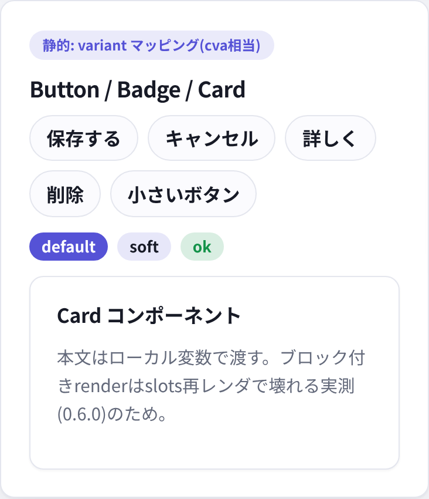
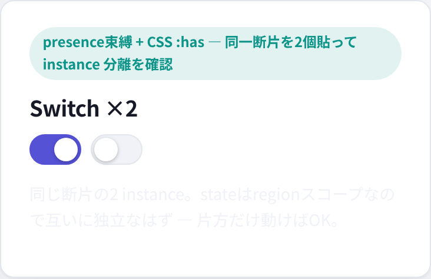
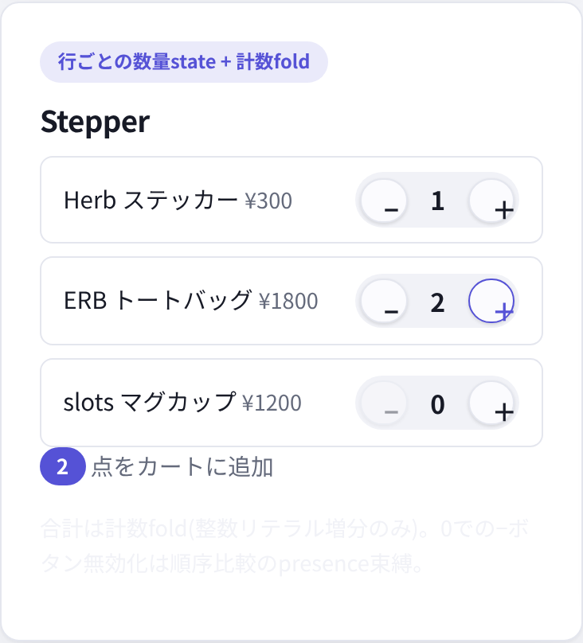
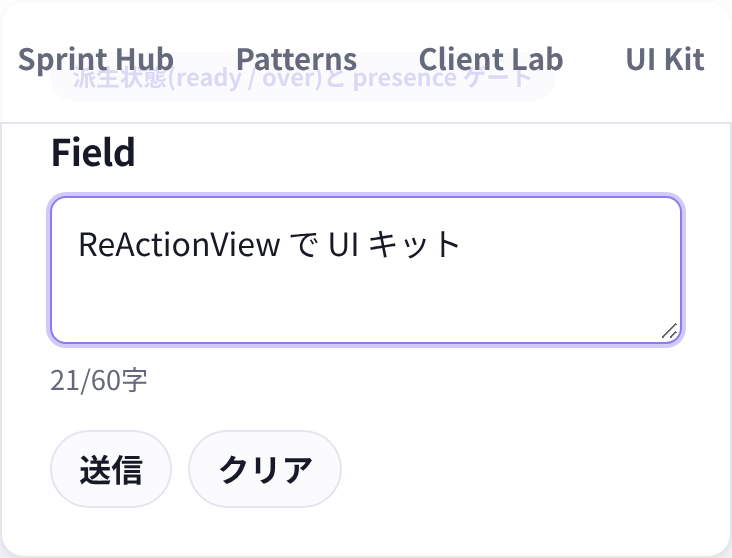
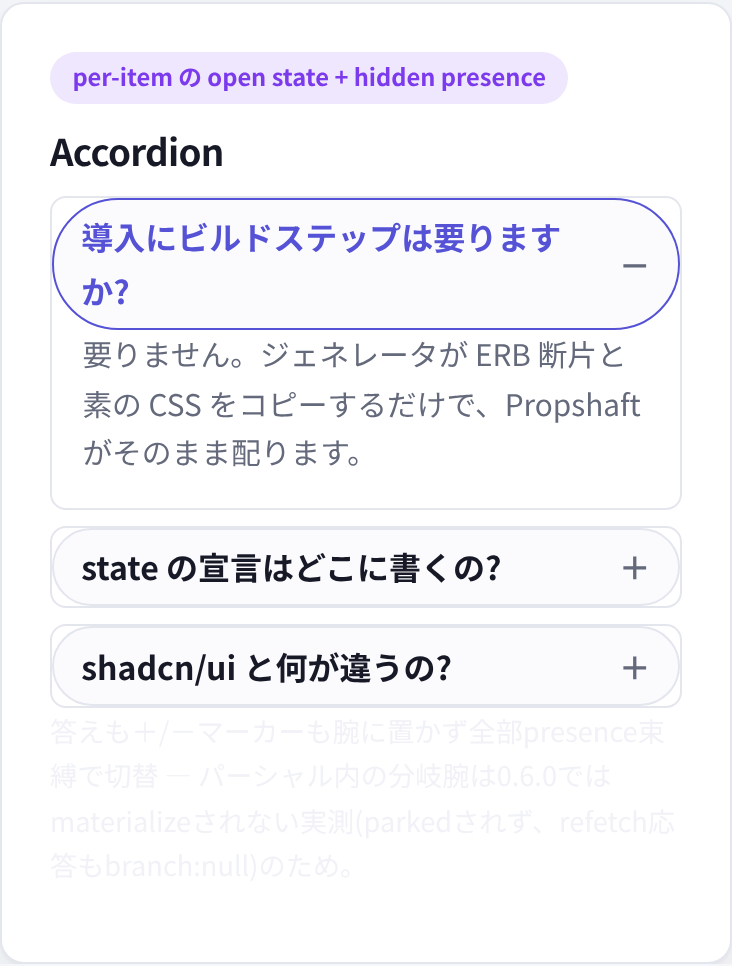
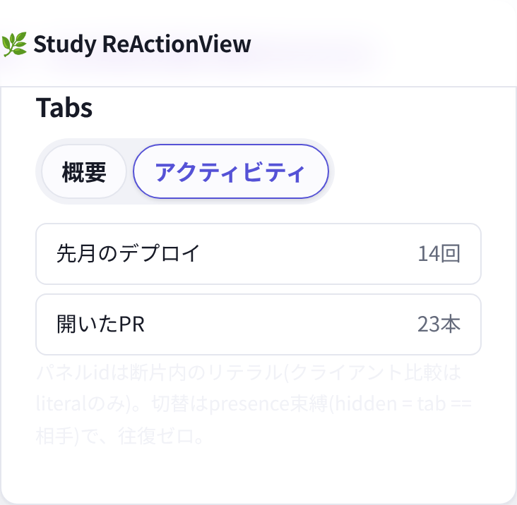
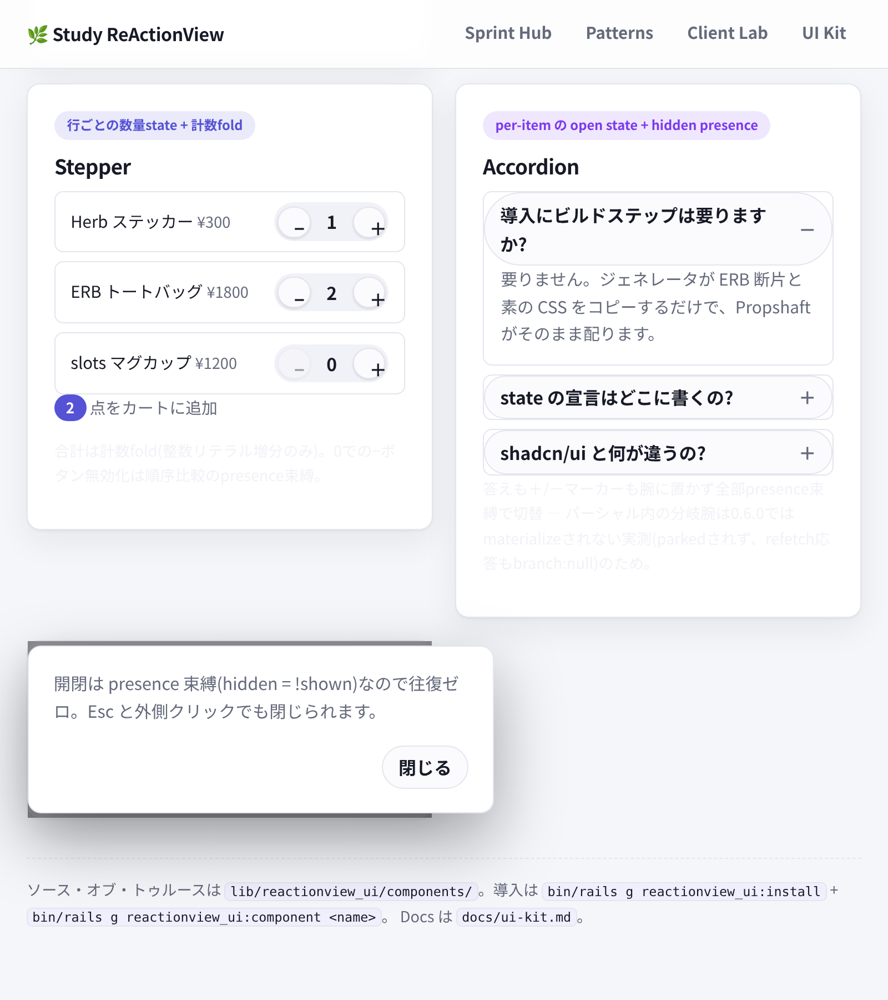

# reactionview-ui — shadcn/ui モデルの ReActionView 検証キット

「shadcn/ui のようなコンポーネントライブラリは ReActionView で作れるか?」への実測の答え。
9コンポーネントを `lib/reactionview_ui/` にソース・オブ・トゥルースとして置き、ジェネレータで
アプリにコピーする — shadcn と同じ**ソース配布モデル**を ERB + 素の CSS + ビルドステップゼロで再現した。

デモ: `/ui`(client mode)。テスト: `test/controllers/ui_controller_test.rb`。

## 検証結果(ブラウザ実測)

headless Chromium で全コンポーネントを操作した結果、**全操作でスロット往復 0**:

| コンポーネント | 実測した操作 | 往復 |
|---|---|---|
| Switch ×2 | 片方だけクリック → `checked` が [true, false](instance分離) | 0 |
| Stepper | +1 ×3 → 行ごとの数量と fold 合計が即時更新、0の行の − は disabled | 0 |
| Field | 入力 → 文字数・over判定・送信ゲートが即時追随 | 0 |
| Accordion | 開閉 → 本文と ＋/－ マーカーが切替 | 0 |
| Tabs | パネル切替 → 選択強調(aria-pressed)とパネル表示 | 0 |
| Dialog | 開く / Esc / 外側クリック / 閉じる | 0 |

コンポーネントは Stimirulus も独自 JS も書かない。挙動は `herb:state` 宣言 + presence 束縛 +
`data-herb-*` 属性だけで、Herb のコンパイラが manifest に落とす。

## 導入(shadcn の init / add に対応)

```console
$ bin/rails g reactionview_ui:install     # トークン+全CSSを reactionview_ui.css に集約、レイアウト配線
$ bin/rails g reactionview_ui:component switch tabs
      force  app/views/components/ui/_tabs.html.erb
```

- 断片は `app/views/components/ui/` に**そのままコピー**(copy_file — `template` だと Thor が
  herb ディレクティブを評価して壊す)。コピー後はアプリ側の所有物なので自由に編集してよい
- gem更新後は `--force` で再生成が update フロー(壊れたら手で直すのが前提のモデル)
- 断片は `herb:state` 宣言を内蔵する。**ページ側の wiring は不要** —

```erb
<%= render "components/ui/switch", label: "通知をミュート" %>
```

## コンポーネント

### Button / Badge / Card(静的)

variant マッピングは cva 相当の素の Hash。state を持たないコンポーネントは
manifest で `"states": null` にコンパイルされ、ワイヤに一切参加しない。

```erb
<%= render "components/ui/button", label: "保存する" %>
<%= render "components/ui/button", label: "削除", variant: "danger" %>
<%= render "components/ui/card", title: "見出し", content: "本文はローカル変数で渡す" %>
```



### Switch

boolean の presence 束縛 + CSS `:has(input:checked)`。同一断片を2個貼ると
occurrence index(`<!--herb-region:...:0-->` / `:1`)ごとに state が独立する実測済み。

```erb
<%= render "components/ui/switch", label: "通知をミュート" %>
```



### Stepper

行ごとの `qty`(scope: 0)+ 計数fold `in_cart`(整数リテラル増分のみ)。fold の読み取りは
リストの後(ループ前で読むとコンパイルエラー)。

```erb
<%= render "components/ui/stepper", items: [{id: 1, name: "マグカップ", price: 1200}] %>
```



### Field

派生状態(`ready: draft != ""` / `over: draft.length > 60`)+ presence ゲート。
textarea は `value=` で束縛(BINDABLE_ELEMENTS、reset が表示まで追従)。

```erb
<%= render "components/ui/field", label: "自己紹介", placeholder: "60字以内で…" %>
```



### Accordion

本文も ＋/－ マーカーも**全部 presence 束縛**(2つの span を貼って hidden で切替)。
per-item の `open`(scope: 0)。

```erb
<%= render "components/ui/accordion", items: [{id: 1, q: "質問", a: "答え"}] %>
```



### Tabs

トリガは `aria-pressed` の文字列補間(CSS は `[aria-pressed="true"]` で引く)、
パネルは `hidden = tab == 相手` の presence。パネルidは断片内の**リテラル** —
クライアント比較は literal のみなので、拡張は断片を編集する(copy-source 流儀)。

```erb
<%= render "components/ui/tabs", overview: @rows_a, activity: @rows_b %>
```



### Dialog

トリガ + state + 背景を1断片で。開閉は `hidden = !shown` の presence、
Esc / 外側クリックは `data-herb-set="keydown.esc@window->shown=false ..."` の
イベント修飾子(lab の palette パターン)。

```erb
<%= render "components/ui/dialog", cta: "詳細を開く", label: "詳細", content: "本文" %>
```



## 0.6.0 で実測した制約(このキットの設計規約)

1. **パーシャル内の分岐腕は materialize されない**: client mode でも腕は parked されず
   (manifest の `fragments: {}`、`<template data-herb-region>` 自体が出ない)、
   refetch 応答も `{"branch": null}` で statics が空。
   → パーシャルでは腕でなく **presence(hidden)+ CSS で切替**する
2. **パーシャル内の render-with-block は slots 再レンダで壊れる**
   (`TypeError: no implicit conversion of Hash into String`)→ 本文は `content:` ローカルで渡す
3. **クライアント比較は literal のみ** → ループデータとの比較(`t[:id] == …`)は不可。
   パネルid等は断片内リテラルにする
4. 計数fold・派生状態・presence・鍵付きコレクションはパーシャル構成でも**完全に動く**
   (manifest はパーシャルごとに出る:`herb:state` は断片自身が所有する)

## ライセンスノート

shadcn/ui 本体は MIT。ただし本キットはコード・テーマ値をコピーしておらず、
拝借しているのは**ソース配布という発想と変数命名の慣習のみ**(アイデアは著作権の対象外)。
ERB 実装とデザイントークン値はこのリポジトリのオリジナル。ライブラリ名に shadcn を使わない
(商標・混同の回避)。
