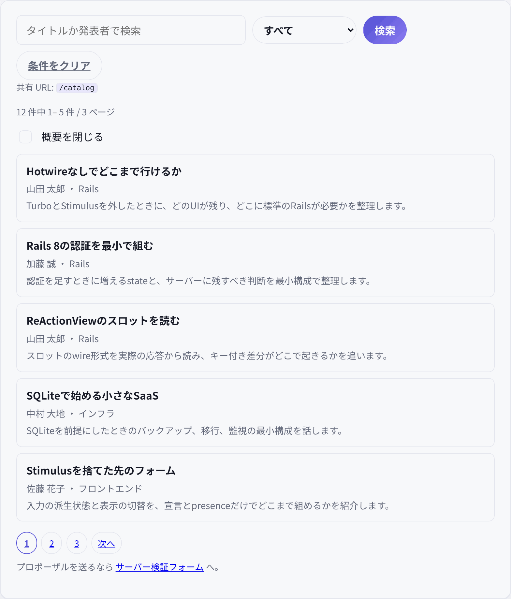

# 共有 URL の検索（`/catalog`） — URL は Rails、ページ内は ReactionView

ReActionView 0.6.0 + herb 0.11.1 の検証アプリで、**検索条件とページを URL に載せ、共有・ブックマーク・戻る・進む・リロードが成立するか**を確かめた記録です。画面は `/catalog`（ナビ外）。検索とページ送りは標準の GET フォームとリンク、概要の開閉だけを client mode の `compact` state にしています。



## 何を確かめたか

既存7画面と `/forms` は、画面内の状態変化を slots で扱うことを示してきました。一方、実アプリが必ず要求する **URL に残る状態**（検索条件・ページ・共有リンク・戻る）は一度も通していません。

ReActionView の state はクライアント所有で、slots 応答は JSON の値です。0.6.0 には URL を書き換える手段がありません。したがって「URL 状態を slots でやる」のではなく、**URL は標準の GET ナビゲーションに任せ、ページ内の一時状態だけを client mode にする**のが素直です。この分担が実務で成立するかを測りました。

## 結論

成立します。検索・カテゴリ・ページは標準の GET で URL に載り、サーバーが絞り込んだ HTML を返します。戻る・進む・共有・リロードはブラウザのナビゲーションとしてそのまま動きます。概要の開閉だけが client mode で、0 slots、URL 不変です。

ブラウザ実測（headless Chromium）では、初期表示・概要の開閉・検索・カテゴリ・ページ送りのすべてで **slots リクエスト 0**。戻る/進む、共有 URL の再現、no-JS の検索も確認しました。

## URL は Rails、ページ内は ReactionView

| 要件 | 担当 | 実装 |
|---|---|---|
| 検索・カテゴリ・ページ・共有・戻る | Rails の標準 GET | `form_with method: :get`、`link_to`、`request.fullpath` |
| ページ内の一時的な表示（概要の開閉） | client mode | `compact` state、checkbox の `checked`、CSS `:has` |
| 書き込みとサーバー検証 | `/forms` | 標準フォーム + 422 の HTML 再描画 |
| サーバー読みの細粒度更新 | slots | Hub / Patterns / Pricing など |

URL 状態とページ内状態を同じ state に混ぜません。`compact` は URL に載せず、検索やページ送りのたびにサーバーへ送りません。

## 実装の形

```erb
<%= form_with url: catalog_path, method: :get, class: "catalog-search" do |form| %>
  <%= form.search_field :q, value: @query, class: "field" %>
  <%= form.select :category, ..., { selected: @category }, class: "select" %>
  <button type="submit" class="btn btn-primary">検索</button>
<% end %>
```

```erb
<p class="share-url">共有 URL: <code><%= request.fullpath %></code></p>
```

- 検索ボタンは `form.submit` ではなく、名前のない `<button type="submit">` にしています。`form.submit` は `commit=検索` を GET の URL に足し、共有 URL 行がノイズまみれになるためです。
- `q` はタイトルと発表者の部分一致。`%` / `_` / `\` はエスケープし、`ESCAPE` をバインドで渡します。
- `category` は `all` / `rails` / `frontend` / `infra`。未指定・空・`all` はそのまま受理し、リダイレクトしません。
- `page` は 1 始まり。整数でない値、1未満、ページ数超過だけ、先頭/末尾へ clamp した正規 URL に 302 で寄せます。`page=1` は有効なままです。
- ページリンクは `catalog_params(page:)` で、`q` が空・`category=all`・`page=1` を落とします。検索フォームは `q=&category=all` を送ることがありますが、共有 URL 行は実際のリクエストをそのまま見せます。
- no-JS でも検索フォーム・ページリンク・概要の閲覧は動きます。

## ページ内 state と 0.6.0 のギャップ

```erb
<%# herb:slots client %>
<%# herb:state (compact: false) %>

<label class="task-check catalog-compact">
  <input type="checkbox" checked="<%= compact %>">
  <span>概要を閉じる</span>
</label>
```

```css
.catalog:has(.catalog-compact input:checked) .catalog-abstract { display: none; }
```

- 当初は各概要に `hidden="<%= compact %>"` の presence を置きましたが、**サーバー側で描いたコレクション内の presence は最後の1件にしか当たりませんでした**（0.6.0 実測）。5件のうち5件目だけが隠れ、残り4件は見えたままでした。
- そのため概要は CSS `:has(.catalog-compact input:checked)` で閉じ、checkbox の `checked` は `compact` state の presence として残しています。checkbox の切替は 0 slots、URL 不変です。
- no-JS では checkbox は state を持ちませんが、CSS は効くので、既定では概要が見え、チェックすれば閉じられます。
- 検索・ページ送りは全画面 GET なので、`compact` は通常は既定の「開いた」に戻ります。ただし戻る/進むでブラウザの **bfcache** が使われると、チェック状態が復元されることがあります（実測。GIF の最後のフレーム）。リロードや新しい GET では既定に戻ります。

## 実測

ブラウザ実測は `/tmp/opencode/capture/catalog-probe.js`（headless Chromium、リポジトリ外）。

| 操作 | document | slots | 結果 |
|---|---|---|---|
| 初期表示 | 1 | 0 | 5件 / 3ページ、共有 URL `/catalog` |
| 概要を閉じる / 開く | 0 | 0 | 5件の概要が隠れる / 戻る。URL 不変 |
| 検索 `ReActionView` | 1 | 0 | 1件、`?q=ReActionView` |
| カテゴリ `rails` | 1 | 0 | 5件 / 2ページ、`?q=&category=rails` |
| ページ2 | 1 | 0 | 1件、`?q=&category=rails&page=2` |
| 戻る / 進む | bfcache | 0 | ページ1 ↔ ページ2 |
| 共有 URL | 1 | 0 | ページ2が再現 |
| no-JS 検索 | 1 | 0 | 絞り込み。概要は既定で見える |

プローブの要約は `initialSlots: 0`, `compactSlots: 0`, `searchSlots: 0`, `categorySlots: 0`, `pageSlots: 0`, `backForward: true`, `sharedURL: true`, `noJS: true`, `documentRequests: 6` です。

統合テストでは次を固定しています。

- `?q` / `?category` / `?page` の単独・組み合わせ、`q` の LIKE エスケープ。
- rails 6件で2ページ、`?category=rails&page=2` が1件。
- 不明なカテゴリ、`page=abc` / `page=0` / `page=999` の 302。`category=all` / `page=1` は 200。
- 0件の空状態、共有 URL 行、GET フォーム、`compact` のマニフェスト。

## 制約

- 検索のたびに全画面リロードします。インクリメンタル検索やオートコンプリートはありません。
- `compact` は URL に載りません。通常の GET では既定に戻り、bfcache では復元されることがあります。
- 検索フォームは空の `q=` や `category=all` を URL に含めることがあります。ページリンクは既定値を落としますが、フォーム送信の URL は実際のリクエストのままです。
- `if @pages > 1` が false のとき、client mode のコンパイル都合で空の `<nav class="pagination">` ラッパーは HTML に残ります。ページリンクは出ません（テストは `.pagination a` を見ています）。
- 認証、書き込み、i18n、全文検索、複数ソートは対象外です。

## Why not slots + URL glue

`herb:state-change` を拾って `history.replaceState` し、`popstate` で `HerbRuntime.state.set` + `refresh()` する方法は成立します。ただし次のコストがあります。

- アプリに約30行のカスタム JS が入り、「カスタム JS なし」の主張が限定される。
- 入力のデバウンス、URL 更新、slots リクエストの順序を自分で揃える必要がある。URL が先に進んで一覧が古い瞬間が生まれる。
- `$refresh` を入力に付けると、デバウンスを迂回してリクエストが増える。

このページは「URL は Rails、ページ内は ReactionView」の分担を固定するのが目的なので、標準 GET を選びました。リアクティブ検索と URL の両立が必要になったら、上の糊を別の実験として測るのが順序です。

## 使い分け

- URL・共有・戻る・ブックマークが要件なら、標準の GET フォームとリンクにする。
- ページ内だけの一時状態（開閉、密度、選択）は client mode の state と presence / CSS にする。
- サーバー検証が必要な書き込みは `/forms` の標準フォーム + 422 にする。
- サーバー読みの細粒度更新は slots に残す。

3つを同じ画面に置いても干渉しない、というのが `/catalog` と `/forms` の実測です。
