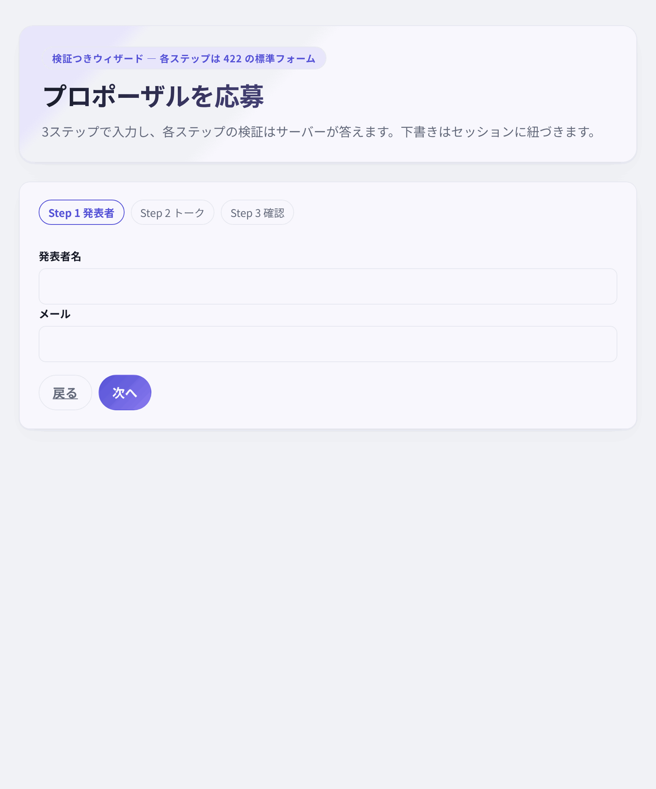

# 検証つきウィザード（`/apply`） — 各ステップが 422 で答える多段フォーム

ReActionView 0.6.0 + herb 0.11.1 の検証アプリで、**3ステップの応募ウィザード**を標準フォームだけで組み立てた記録です。画面は `/apply`（ナビ外）。各ステップはサーバーで検証し、失敗は 422 の HTML 全画面再描画でエラーと入力値を保持します。下書きは DB に保存し、セッションで紐づけます。



## 何を確かめたか

`/forms` は1画面の作成・編集・削除を実証しました。実務の応募・オンボーディングは多段で、各ステップの検証と「戻る」が要ります。

- ステップごとの 422 が、入力値とエラーを保ったまま同じステップに戻せるか。
- 下書きをセッションに紐づけ、戻る・リロード・no-JS で同じ状態に戻れるか。
- 最後の確定で `Proposal` を作成し、下書きとセッションを後始末できるか。
- すべて標準フォームで、slots 0 で動くか。

## 結論

動きます。`ApplicationDraft` の下書きをセッションの id で引き、`?step=` の GET と PATCH で進めます。各ステップの無効入力は `422 text/html` で同じステップを再描画し、`Proposal` は最後の確認でトランザクションに作成します。

ブラウザ実測（headless Chromium）では、ステップ1/2の 422、戻る、確認、送信、no-JS の全経路で **slots 0**。document 12。

## 3ステップと下書き

| ステップ | 入力 | 検証 |
|---|---|---|
| 1 発表者 | 発表者名、メール | presence、40字、メール形式 |
| 2 トーク | タイトル、概要、カテゴリ | presence、5..80 / 30..600、カテゴリ inclusion |
| 3 確認 | なし（表示と送信） | 全項目（飛ばし URL への防御） |

- 下書きは `ApplicationDraft`（5項目）に保存。`step` は DB に持たない仮想属性で、現在のステップの検証にだけ使う。
- セッションは `session[:application_draft_id]`。URL に下書き id は出さない。
- ステップを飛ばして `?step=3` を開いても、最後の PATCH で全項目の検証が走る。空なら 422。
- 無効なステップは `render :show, status: :unprocessable_entity`。エラー要約と項目別エラー、入力値が残る。
- 最後の PATCH は `ApplicationDraft.transaction` で `Proposal.create!` と下書き削除を行い、セッションを消して `/forms` に flash 付きで戻る。

## 実装の形

```ruby
get "/apply", to: "applications#show", as: :apply
patch "/apply", to: "applications#update"
```

- `show` は `step` を 1..3 に clamp し、セッションの下書きを `@application` に。
- `update` はステップのフィールドだけ assign し、`@application.step = @step` で検証。
- ステップ1/2は `form_with model: @application, url: apply_path(step: n), method: :patch`。
- ステップ3はフィールドなしの `form_with url: apply_path(step: 3), method: :patch`。確認は `dl` で表示。
- 戻るは GET リンク（ステップ2→1、ステップ3→2）。ステップ1の戻るは `/forms`。
- no-JS でもフォームとリンクだけで動く。

```erb
<%= form_with url: apply_path(step: 3), method: :patch, class: "wizard-form" do |form| %>
  <%= link_to "戻る", apply_path(step: 2), class: "btn btn-ghost" %>
  <%= form.submit "送信する", class: "btn btn-primary" %>
<% end %>
```

## 実測

ブラウザ実測は `/tmp/opencode/capture/apply-probe.js`（headless Chromium、リポジトリ外）。

| 操作 | document | slots | 結果 |
|---|---|---|---|
| `/apply` 初期 | 1 | 0 | ステップ1、下書き作成 |
| ステップ1 無効 | 1（PATCH） | 0 | 422、エラーとメール値が残る |
| ステップ1 有効 | 1（PATCH）→ GET | 0 | `?step=2` |
| ステップ2 無効 | 1（PATCH） | 0 | 422、タイトル値が残る |
| ステップ2 有効 | 1（PATCH）→ GET | 0 | `?step=3` |
| 戻る | 1（GET） | 0 | `?step=2`、値が残る |
| 送信 | 1（PATCH）→ GET | 0 | `/forms`、flash、新しいカード |
| no-JS | 同じ | 0 | 3ステップが動く |

プローブの要約は `step1_422: true`, `step2_422: true`, `back: true`, `created: true`, `noJS: true`, `slots: 0`, `documents: 12` です。

統合テストでは、ステップごとの 422 と値保持、ステップの clamp（`?step=99` → 3、`?step=0` → 1）、飛ばし URL の 422、2セッションの下書き分離、最後の `Proposal` +1 / `ApplicationDraft` -1 とセッション削除を固定しています。

## 制約

- ブラウザの戻る/進むは PATCH の履歴を含むため、再送信の確認が出ることがあります。明示的な「戻る」GET を正とします。
- 放棄された下書きは DB に残ります。自動削除は今回の対象外です。
- 下書きは Cookie セッションの id で引きます。別端末・別ブラウザでは再開できません。
- ステップを飛ばす URL は許可しますが、そのステップの検証で弾きます。
- ウィザードへのリンクは README / Patterns footer / docs からで、`/forms` の画面とメディアは変えていません。

## 使い分け

- 1画面で完結する作成・編集・削除は `/forms` の標準フォーム + 422。
- 多段の応募・オンボーディングは `/apply` のように、各ステップ GET/PATCH + セッション下書き + 422。
- 検索・共有 URL は `/catalog` の標準 GET。
- ページ内の一時状態だけを client mode の state に残す。

どの経路も slots 0 で、ReActionView のクライアントはページ内の細粒度更新に集中できます。
